# Лабораторная работа №1: Настройка среды разработки и первый HTTP-сервер

**Студент:** Попова Виктория Романовна
**Группа:** ПИЖ-б-о-25-1(1)
**Вариант:** 11
**Технология:** Python + Flask

## Содержание
- [Цель работы](#цель-работы)
- [Теоретическое обоснование](#теоретическое-обоснование)
- [Выполнение практического примера](#выполнение-практического-примера)
- [Выполнение индивидуального задания](#выполнение-индивидуального-задания)
- [Контрольные вопросы](#контрольные-вопросы)
- [Вывод](#вывод)
- [Список использованных источников](#список-использованных-источников)

## Цель работы
Освоить установку инструментов для бэкенд-разработки, создать и запустить минимальный веб-сервер, обрабатывающий GET-запросы, понять концепцию эндпоинтов, научиться настраивать автоматический перезапуск сервера.

## Теоретическое обоснование
### *1. Что такое бэкенд-разработка*

**Бэкенд (backend)** - это серверная часть веб-приложения, которая отвечает за обработку запросов от клиентов, взаимодействие с базами данных, выполнение бизнес-логики и формирование ответов. Бэкенд работает на сервере и не виден пользователю напрямую.

**Клиент-серверная архитектура**
В веб-разработке взаимодействие строится по модели «клиент-сервер»: ̵
- Клиент (браузер, мобильное приложение) отправляет HTTP-запрос. ̵
- Сервер (бэкенд-приложение) принимает запрос, обрабатывает его и отправляет HTTP-ответ.

### *2. Эндпоинты и маршруты*

**Эндпоинт (endpoint)** - это конкретный адрес (URL) вместе с методом HTTP, по которому клиент обращается к серверу для получения ресурса.

**Маршрут (route)** - это механизм сопоставления пути запроса с кодом обработчика на стороне сервера.

**Протокол HTTP и метод GET**
**HTTP** - основной протокол передачи данных в интернете.

### *3. Что такое JSON*

**JSON (JavaScript Object Notation)** - текстовый формат обмена данными, который стал стандартом де-факто для REST API.

### *4. Выбор технологического стека*

Для работы выбран стек Python + Flask.

**Python** - высокоуровневый язык программирования с простым и читаемым синтаксисом. Он широко используется в бэкенд-разработке, анализе данных и автоматизации. Для учебного проекта Python удобен тем, что позволяет быстро писать код без лишних конструкций.

**Flask** - лёгкий веб-фреймворк (микрофреймворк) для Python. Он предоставляет минимальный набор инструментов для создания веб-сервера и REST API:
  - маршрутизация через декораторы (`@app.route(...)`);
  - возврат текстовых ответов и JSON (`jsonify`);
  - обработка параметров пути (`<int:id>`);
  - обработка ошибок (например, 404);
  - встроенный режим отладки с автоматическим перезапуском (`debug=True`).

Python + Flask: легкий фреймворк на самом популярном языке для бэкенда.

### *5. Автоматический перезапуск (Hot Reload)*

При разработке мы часто меняем код. Чтобы не останавливать и не запускать сервер вручную каждый раз, мы используем для Python режим debug=True во Flask.

## Ход выполнения лабораторной работы:
### 1. Выполнение практического примера

```python
from flask import Flask, jsonify, request
import time

app = Flask(__name__)


@app.before_request
def log_request():
    print(f"[{time.strftime('%Y-%m-%d %H:%M:%S')}] {request.method} {request.path}")


@app.route('/')
def home():
    return 'Добро пожаловать на базовый сервер!'


@app.route('/api/status')
def status():
    return jsonify({"status": "ok", "framework": "Flask"})


@app.route('/api/info')
def info():
    return jsonify({"author": "Student", "version": "1.0.0"})


@app.route('/api/users/<int:user_id>')
def get_user(user_id):
    return jsonify({"message": "Информация о пользователе", "userId": user_id})


@app.errorhandler(404)
def not_found(_error):
    return jsonify({"error": "Маршрут не найден"}), 404


if __name__ == '__main__':
    app.run(port=3000, debug=True)
```
### Проверка

1. http://localhost:3000

<p align="center">
  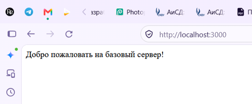
  <br>
  <em>Рисунок 1 - Текстовый ответ корневого эндпоинта практического примера</em>
</p>

2. http://localhost:3000/api/status

<p align="center">
  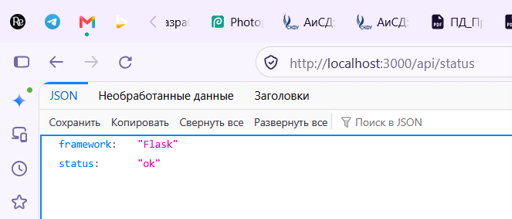
  <br>
  <em>Рисунок 2 - JSON-ответ эндпоинт 1 практического примера</em>
</p>

3. http://localhost:3000/api/info

<p align="center">
  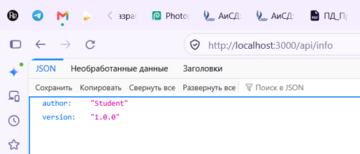
  <br>
  <em>Рисунок 3 - JSON-ответ эндпоинт 2 практического примера</em>
</p>

4. http://localhost:3000/api/users/5

<p align="center">
  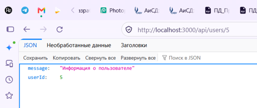
  <br>
  <em>Рисунок 4 - JSON-ответ эндпоинта с параметром 5 практического примера</em>
</p>

5. http://localhost:3000/api/users/123

<p align="center">
  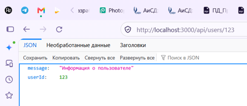
  <br>
  <em>Рисунок 5 - JSON-ответ эндпоинта с параметром 123 практического примера</em>
</p>

6. http://localhost:3000/anything-else

<p align="center">
  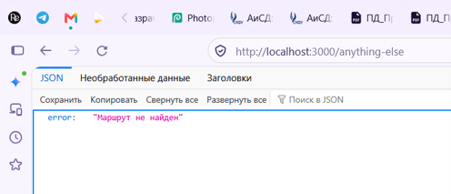
  <br>
  <em>Рисунок 6 - Обработка ошибки 404 в практическом примере</em>
</p>

### 2. Выполнение индивидуального задания

*Требования:*
- 5 эндпоинтов (1 текстовый, 2 простых JSON-эндпоинта, 1
JSON-эндпоинт с параметром в пути, 1 обработчик 404);
- автоматический перезапуск;
- реализация простого консольного логирования всех входящих запросов (метод + URL + время).

<p align="center">
  
  <br>
</p>

*Код сервера (python)*

```python
from flask import Flask, jsonify, request
import time

app = Flask(__name__)

# Console request logging


@app.before_request
def log_request():
    print(f"[{time.strftime('%Y-%m-%d %H:%M:%S')}] {request.method} {request.path}")

# 1. Text endpoint


@app.route('/')
def home():
    return 'Добро пожаловать на сервер рецептов и поваров!'

# 2. JSON endpoint 1


@app.route('/api/recipes')
def get_recipes():
    recipes = [
        {"id": 1, "name": "Сырники", "calories": 160},
        {"id": 2, "name": "Роллы Филадельфия", "calories": 180},
        {"id": 3, "name": "Хинкали", "calories": 200}
    ]
    return jsonify(recipes)

# 3. JSON endpoint 2


@app.route('/api/chefs')
def get_chefs():
    chefs = [
        {"id": 1, "name": "Ивлев", "cuisine": "Русская"},
        {"id": 2, "name": "Агзамов", "cuisine": "Десерты со всего мира"},
        {"id": 3, "name": "Гроле", "cuisine": "Французская"}
    ]
    return jsonify(chefs)

# 4. JSON endpoint with a parameter 1


@app.route('/api/recipes/<int:recipe_id>')
def get_recipe(recipe_id):
    return jsonify({
        "requestedId": recipe_id,
        "status": "success"
    })

# 5.JSON endpoint with a parameter 2


@app.route('/api/chefs/<name>')
def get_chef(name):
    return jsonify({
        "requestedName": name,
        "status": "success"
    })

# Processing 404


@app.errorhandler(404)
def not_found(_error):
    return jsonify({"error": "Маршрут не найден"}), 404


if __name__ == '__main__':
    app.run(port=3000, debug=True)

```
### Проверка

1. http://localhost:3000

<p align="center">
  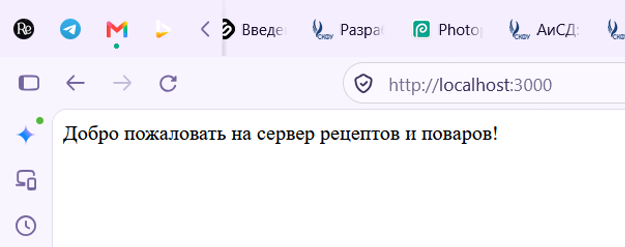
  <br>
  <em>Рисунок 7 - Текстовый ответ эндпоинта</em>
</p>

2. http://localhost:3000/api/recipes

<p align="center">
  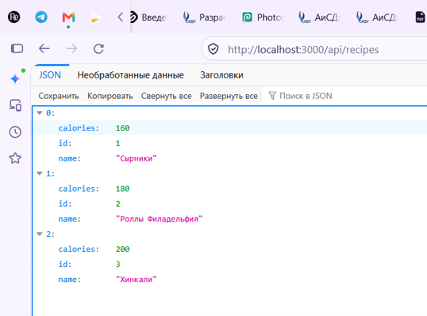
  <br>
  <em>Рисунок 8 - JSON-ответ эндпоинт 1</em>
</p>

3. http://localhost:3000/api/chefs

<p align="center">
  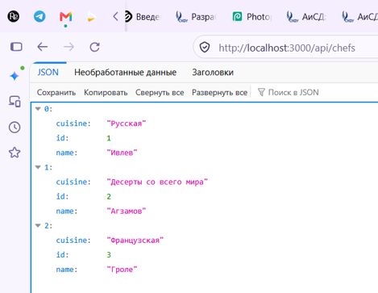
  <br>
  <em>Рисунок 9 - JSON-ответ эндпоинт 2</em>
</p>

4. http://localhost:3000/api/recipes/1

<p align="center">
  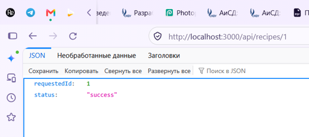
  <br>
  <em>Рисунок 10 - JSON-ответ эндпоинт с параметром 1</em>
</p>

5. http://localhost:3000/api/recipes/123

<p align="center">
  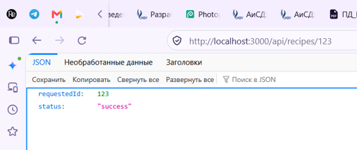
  <br>
  <em>Рисунок 11 - JSON-ответ эндпоинта с параметром 123</em>
</p>

6. http://localhost:3000/api/chefs/Grole

<p align="center">
  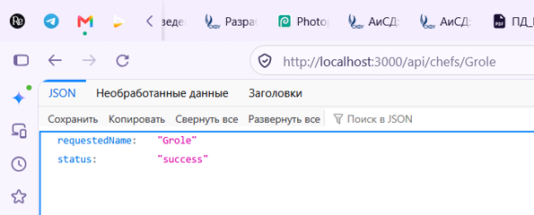
  <br>
  <em>Рисунок 12 - JSON эндпоинт с параметром Grole</em>
</p>

7. http://localhost:3000/anything-else

<p align="center">
  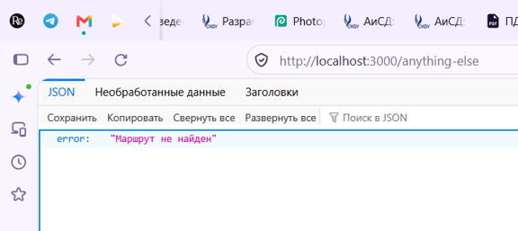
  <br>
  <em>Рисунок 13 - JSON-ответ при обработке ошибки 404</em>
</p>

### 3. Ответить на контрольные вопросы

#### **Контрольные вопросы:**

**1. Что такое клиент-серверная архитектура?**

Это модель взаимодействия, при которой **клиент** (браузер, мобильное приложение) отправляет HTTP-запрос, а **сервер** (бэкенд-приложение) принимает его, обрабатывает и возвращает HTTP-ответ.

**2. Какой протокол используется для общения клиента и сервера в вебе?**

**HTTP** (HyperText Transfer Protocol) - основной протокол передачи данных в интернете. В работе используется метод **GET**, который только запрашивает данные и не изменяет состояние сервера.

**3. Что такое эндпоинт (endpoint)?**

**Эндпоинт (endpoint)** - это конкретный **адрес (URL) + метод HTTP**, по которому клиент обращается к серверу за ресурсом. Например:
- `GET /` - корневой эндпоинт;
- `GET /api/recipes` - список рецептов;
- `GET /api/recipes/5` - рецепт с ID = 5.

**4. Какую структуру имеет HTTP-запрос и HTTP-ответ? Что такое код состояния (status code)?**

**HTTP-запрос** состоит из:
- строки запроса (метод + путь + версия протокола);
- заголовков (Headers);
- тела (Body) - необязательно для GET.

**HTTP-ответ** состоит из:
- строки состояния (версия + код + пояснение);
- заголовков;
- тела (данные: HTML, JSON, текст).

**Код состояния (status code)** - трёхзначное число, показывающее результат обработки запроса:
- `200` - OK (успех);
- `404` - Not Found (ресурс не найден);
- `500` - Internal Server Error (ошибка на сервере).

**5. Что такое JSON? Почему он популярен в веб-разработке?**

**JSON (JavaScript Object Notation)** - текстовый формат обмена данными, который стал стандартом де-факто для REST API.

Популярен так как:

- легко читается человеком и автоматически разбирается машиной;

- не зависит от языка программирования;

- компактнее XML;

- стандарт де-факто для REST API.

**6. Как запустить сервер на Node.js или Flask?**

В PyCharm - правой кнопкой на app.py: Run 'app'.

В Node.js + Express:
```bash
npm run dev   # через nodemon 
```
или
```bash
node app.js
```

**7. Что такое автоматический перезапуск сервера и зачем он нужен? Какой пакет используется для Node.js?**

**Автоматический перезапуск (Hot Reload)** - это функция, при которой сервер сам перезапускается после изменения кода, без ручной остановки и запуска.

Для Node.js: nodemon.

Для Python: режим debug=True во Flask. 

**8. Какие коды состояния HTTP вы знаете? За что отвечает код 404?**

Основные группы:

- 2xx - успех: 200 OK, 201 Created.

- 3xx - перенаправление: 301 Moved Permanently, 302 Found.

- 4xx - ошибка клиента: 400 Bad Request, 401 Unauthorized, 403 Forbidden, 404 Not Found.

- 5xx - ошибка сервера: 500 Internal Server Error, 503 Service Unavailable.

Код 404 (Not Found) означает, что запрошенный ресурс (URL) не найден на сервере.

**9. Что такое middleware в Express / декораторы запросов во Flask?**

**Middleware в Express** - это функция, которая выполняется до или после обработки запроса (логирование, проверка авторизации).

**Декораторы во Flask** - это функции-обёртки, которые «прикрепляют» поведение к другой функции (регистрация маршрута, логирование, обработка ошибки 404).

**10. Как получить параметр из URL-пути (например, ID пользователя) в вашем фреймворке?**

Во Flask параметр указывается в маршруте в угловых скобках с типом:

```python
@app.route('/api/recipes/<int:recipe_id>')
def get_recipe(recipe_id):
    return jsonify({"requestedId": recipe_id})
```

Когда клиент заходит на /api/recipes/5, Flask передаёт в функцию recipe_id = 5, и она возвращает JSON с этим значением.

## Вывод 

В ходе лабораторной работы была освоена установка инструментов для бэкенд-разработки, создан и запущен минимальный веб-сервер на Python + Flask, обрабатывающий GET-запросы.

В рамках индивидуального задания были реализованы текстовый и JSON-эндпоинты, эндпоинты с параметрами, обработка ошибки 404 и консольное логирование запросов. Также настроен автоматический перезапуск сервера.

## Список использованных источников

1. **Python официальная документация** - https://docs.python.org/3/
2. **Flask официальная документация** - https://flask.palletsprojects.com/
3. **HTTP протокол и коды состояния (MDN)** - https://developer.mozilla.org/ru/docs/Web/HTTP
4. **JSON (MDN)** - https://developer.mozilla.org/ru/docs/Web/JavaScript/Reference/Global_Objects/JSON
5. **PyCharm: создание виртуального окружения** - https://www.jetbrains.com/help/pycharm/creating-virtual-environment.html