# Лабораторная работа №2: Изучение HTTP-методов и CRUD-операции

**Студент:** Попова Виктория Романовна
**Группа:** ПИЖ-б-о-25-1(1)
**Вариант:** 11
**Технология:** Python + Flask

## Содержание
- [Цель работы](#цель-работы)
- [Теоретическое обоснование](#теоретическое-обоснование)
- [Выполнение практического примера](#выполнение-практического-примера)
- [Выполнение индивидуального задания](#выполнение-индивидуального-задания)
- [Контрольные вопросы](#контрольные-вопросы)
- [Вывод](#вывод)
- [Список использованных источников](#список-использованных-источников)

## Цель работы
Освоить обработку различных HTTP-методов (GET, POST, PUT, DELETE) в Flask. Научиться реализовывать CRUD-операции над коллекцией объектов, хранящейся в памяти сервера, а также возвращать корректные HTTP-коды ответов (200, 201, 404, 400). Освоить тестирование API с помощью инструмента Postman.

## Теоретическое обоснование

### *1. Что такое CRUD*

**CRUD** — это акроним, обозначающий четыре базовые операции над данными:
- **Create** (Создание) — добавление новой записи (HTTP-метод `POST`).
- **Read** (Чтение) — получение данных (HTTP-метод `GET`).
- **Update** (Обновление) — изменение существующей записи (HTTP-методы `PUT` или `PATCH`).
- **Delete** (Удаление) — удаление записи (HTTP-метод `DELETE`).

В реляционных базах данных этим операциям соответствуют SQL-команды: `INSERT`, `SELECT`, `UPDATE` и `DELETE`.

### *2. HTTP-методы*

В отличие от первой лабораторной работы, где использовался только метод `GET`, для реализации CRUD необходимы все основные методы HTTP.

- **POST** — используется для создания нового ресурса. Передаёт данные в теле запроса. Не является идемпотентным (два одинаковых запроса создадут две разные записи).
- **GET** — используется для чтения данных. Не должен изменять состояние сервера (является безопасным и идемпотентным). Тело запроса отсутствует.
- **PUT** — используется для полного обновления существующего ресурса. Передаёт новые данные в теле запроса. Является идемпотентным (повторный запрос даёт тот же результат).
- **DELETE** — используется для удаления ресурса. Тело запроса обычно отсутствует. Является идемпотентным.

**Идемпотентность** — это свойство HTTP-метода, при котором повторное выполнение одного и того же запроса приводит к тому же состоянию сервера, что и однократное выполнение.

### *3. Коды состояния HTTP (Status Codes)*

При работе с CRUD-операциями сервер должен возвращать корректные коды состояния, чтобы клиент понимал результат запроса:
- `200 OK` — успешный запрос (используется для GET, PUT, DELETE).
- `201 Created` — ресурс успешно создан (используется для POST).
- `204 No Content` — успешный запрос, но ответ не содержит тела (часто для DELETE).
- `400 Bad Request` — ошибка в данных запроса (например, не передан обязательный параметр или неверный формат JSON).
- `404 Not Found` — запрошенный ресурс не найден (например, запрос элемента с несуществующим ID).
- `500 Internal Server Error` — внутренняя ошибка сервера.

### *4. Хранение данных в памяти*

В данной лабораторной работе не используется база данных. Данные хранятся в оперативной памяти сервера в виде массива (списка) объектов.
- **Преимущества:** простота реализации, не требуется установка и настройка СУБД, быстрый доступ.
- **Недостатки:** данные полностью теряются при перезапуске сервера, что не подходит для реальных (production) проектов.

### *5. Инструмент для тестирования API — Postman*

Обычный браузер умеет отправлять только GET-запросы. Для проверки методов `POST`, `PUT` и `DELETE` (с передачей JSON в теле запроса) используется специальный инструмент — **Postman**. Он позволяет формировать HTTP-запросы с любыми методами, заголовками и телом, а также наглядно отображать ответы сервера (в формате JSON) и коды состояния.

## Ход выполнения лабораторной работы:
### 1. Выполнение практического примера

В качестве практического примера реализован REST API для управления товарами (`items`). Данные хранятся в памяти сервера (в списке Python).

**Код сервера (`practical2.py`):**

```python
from flask import Flask, jsonify, request

app = Flask(__name__)

items = [
    {"id": 1, "name": "Товар 1", "price": 100, "quantity": 5},
    {"id": 2, "name": "Товар 2", "price": 200, "quantity": 3},
    {"id": 3, "name": "Товар 3", "price": 300, "quantity": 10}
]

next_id = 4


@app.route('/items', methods=['GET'])
def get_all_items():
    return jsonify({
        "count": len(items),
        "items": items
    })


@app.route('/items/<int:item_id>', methods=['GET'])
def get_item(item_id):
    item = next((i for i in items if i["id"] == item_id), None)
    if item is None:
        return jsonify({"error": "Элемент не найден"}), 404
    return jsonify(item)


@app.route('/items', methods=['POST'])
def create_item():
    global next_id
    data = request.get_json()

    if not data or 'name' not in data or 'price' not in data:
        return jsonify({"error": "Поля name и price обязательны"}), 400

    new_item = {
        "id": next_id,
        "name": data['name'],
        "price": data['price'],
        "quantity": data.get('quantity', 0)
    }
    items.append(new_item)
    next_id += 1

    return jsonify(new_item), 201


@app.route('/items/<int:item_id>', methods=['PUT'])
def update_item(item_id):
    item = next((i for i in items if i["id"] == item_id), None)
    if item is None:
        return jsonify({"error": "Элемент не найден"}), 404

    data = request.get_json()

    item["name"] = data.get("name", item["name"])
    item["price"] = data.get("price", item["price"])
    item["quantity"] = data.get("quantity", item["quantity"])

    return jsonify(item)


@app.route('/items/<int:item_id>', methods=['DELETE'])
def delete_item(item_id):
    global items
    item = next((i for i in items if i["id"] == item_id), None)
    if item is None:
        return jsonify({"error": "Элемент не найден"}), 404

    items = [i for i in items if i["id"] != item_id]

    return jsonify({
        "message": "Элемент удалён",
        "deleted": item
    })


@app.errorhandler(404)
def not_found(_error):
    return jsonify({"error": "Маршрут не найден"}), 404


if __name__ == '__main__':
    app.run(port=3000, debug=True)
```
### Проверка в Postman для практического примера

**1. GET-запрос (Получение всех элементов)**

<p align="center"> 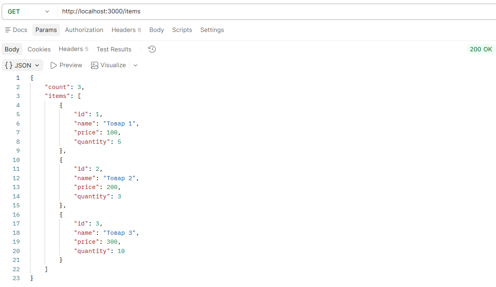 <br> <em>Рисунок 1 - Получение списка всех элементов (GET)</em> </p>

**2. GET-запрос с параметром (получение одного элемента)**

<p align="center"> 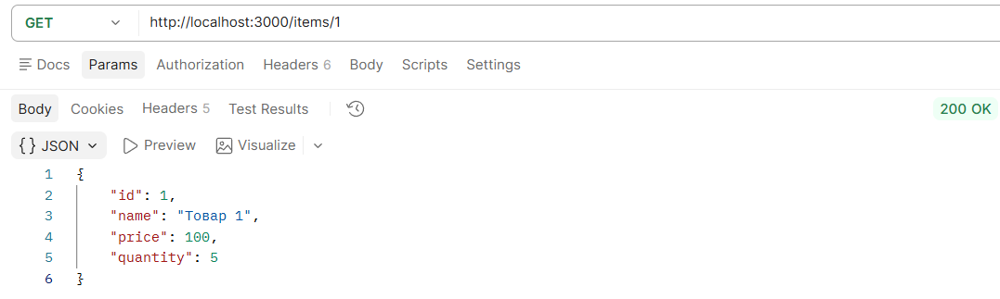 <br> <em>Рисунок 2 - Получение одного элемента по ID</em> </p>

**2.1. GET-запрос (Проверка обработки 404 (Not Found))**

<p align="center"> 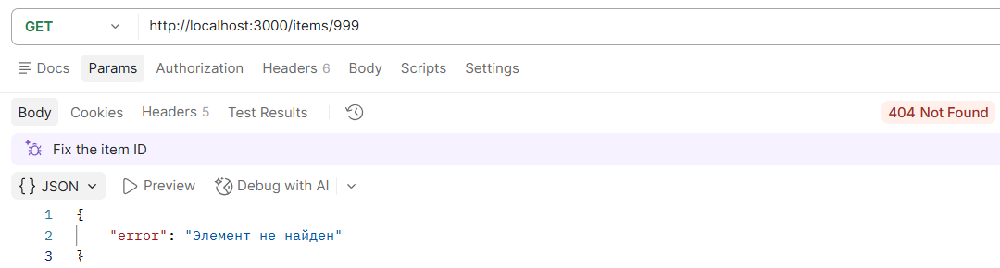 <br> <em>Рисунок 3 - Обработка ошибки 404</em> </p>

**3. POST-запрос (Создание элемента)**

<p align="center"> 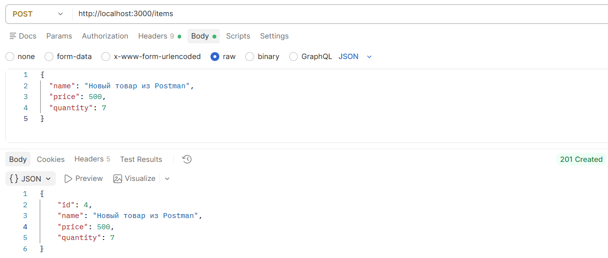 <br> <em>Рисунок 4 - Создание нового элемента (POST)</em> </p>

Проверка, что элемент создан

<p align="center"> 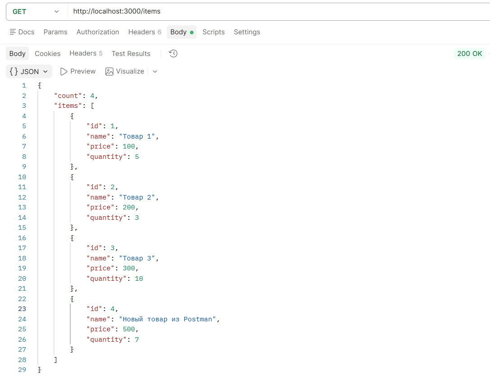 <br> <em>Рисунок 5 - Проверка списка после добавления</em> </p>

**3.1 PUT (Проверка обработки 400 (Bad Request))**

<p align="center"> 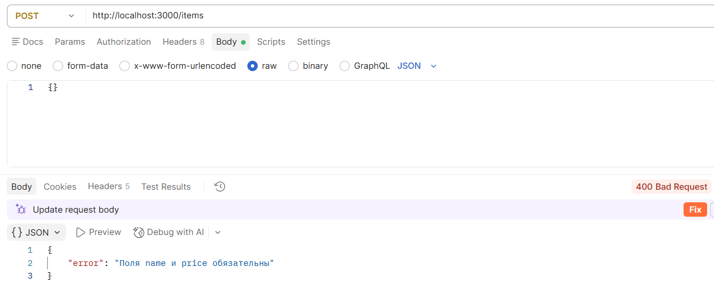 <br> <em>Рисунок 6 - Обработка ошибки 400</em> </p>

**4. PUT-запрос (Обновление элемента)**

<p align="center"> 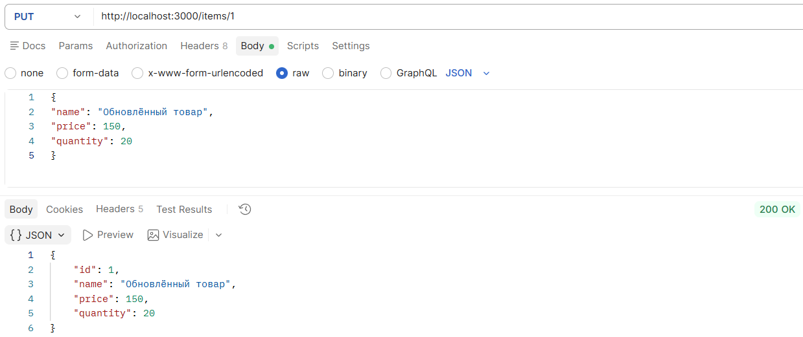 <br> <em>Рисунок 7 - Обновление существующего элемента (PUT)</em> </p>

**5. DELETE-запрос (Удаление элемента)**

<p align="center"> 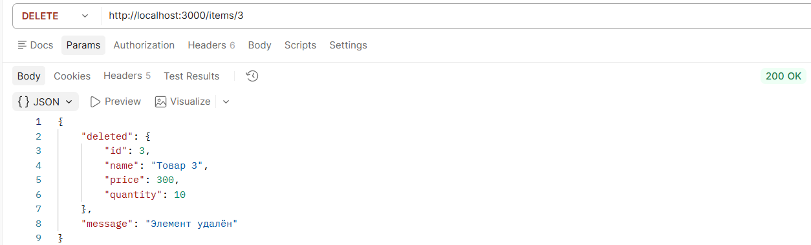 <br> <em>Рисунок 8 - Удаление элемента (DELETE)</em> </p>

Проверка, что элемент удалён

<p align="center"> 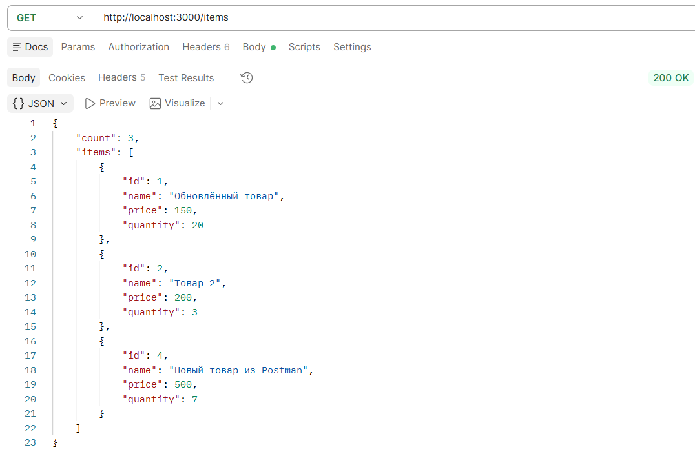 <br> <em>Рисунок 9 - Проверка списка после удаления</em> </p>

<p align="center"> 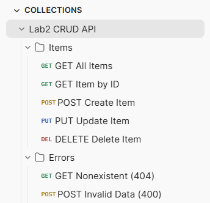 <br> <em>Рисунок 10 - Итоговая структура коллекции</em> </p>

### Выполнение индивидуального задания (Вариант 11, Продвинутый уровень)

**Код сервера (`lab2-backend.py`):**

```python
from flask import Flask, jsonify, request
import logging

app = Flask(__name__)

# Настройка логирования в файл
logging.basicConfig(filename='access.log', level=logging.INFO,
                    format='%(asctime)s - %(message)s')

@app.before_request
def log_request():
    logging.info(f"{request.method} {request.path}")

# Данные (Вариант 11: Рецепты)
items = [
    {"id": 1, "title": "Борщ", "time": 60, "difficulty": "Средне"},
    {"id": 2, "title": "Сырники", "time": 20, "difficulty": "Легко"},
    {"id": 3, "title": "Хинкали", "time": 45, "difficulty": "Сложно"}
]
next_id = 4

# 1. Базовый CRUD + требования среднего уровня

# GET /items (с поиском, сортировкой и пагинацией)
@app.route('/items', methods=['GET'])
def get_all_items():
    search = request.args.get('search')
    if search:
        filtered = [i for i in items if search.lower() in i["title"].lower()]
    else:
        filtered = items.copy()

    sort_field = request.args.get('sort')
    order = request.args.get('order', 'asc')
    if sort_field and filtered and sort_field in filtered[0]:
        reverse = (order == 'desc')
        filtered.sort(key=lambda x: x.get(sort_field, ""), reverse=reverse)

    page = int(request.args.get('page', 1))
    limit = int(request.args.get('limit', 10))
    start = (page - 1) * limit
    end = start + limit
    paginated = filtered[start:end]

    return jsonify({
        "count": len(paginated),
        "items": paginated
    })

# GET /items/<id>
@app.route('/items/<int:item_id>', methods=['GET'])
def get_item(item_id):
    item = next((i for i in items if i["id"] == item_id), None)
    if item is None:
        return jsonify({"error": "Элемент не найден"}), 404
    return jsonify(item)

# POST /items (создание с валидацией)
@app.route('/items', methods=['POST'])
def create_item():
    global next_id
    data = request.get_json()
    
    if not data or 'title' not in data:
        return jsonify({"error": "Поле title обязательно"}), 400
    if 'time' in data and not isinstance(data['time'], int):
        return jsonify({"error": "Поле time должно быть числом"}), 400

    new_item = {
        "id": next_id,
        "title": data['title'],
        "time": data.get('time', 0),
        "difficulty": data.get('difficulty', "Не указано")
    }
    items.append(new_item)
    next_id += 1
    return jsonify(new_item), 201

# PUT /items/<id>
@app.route('/items/<int:item_id>', methods=['PUT'])
def update_item(item_id):
    item = next((i for i in items if i["id"] == item_id), None)
    if item is None:
        return jsonify({"error": "Элемент не найден"}), 404

    data = request.get_json()
    item["title"] = data.get("title", item["title"])
    item["time"] = data.get("time", item["time"])
    item["difficulty"] = data.get("difficulty", item["difficulty"])
    return jsonify(item)

# DELETE /items/<id> (возвращает 204 No Content)
@app.route('/items/<int:item_id>', methods=['DELETE'])
def delete_item(item_id):
    global items
    item = next((i for i in items if i["id"] == item_id), None)
    if item is None:
        return jsonify({"error": "Элемент не найден"}), 404

    items = [i for i in items if i["id"] != item_id]
    return '', 204

# 2. Продвинутый уровень

# PATCH /items/<id> (частичное обновление)
@app.route('/items/<int:item_id>', methods=['PATCH'])
def patch_item(item_id):
    item = next((i for i in items if i["id"] == item_id), None)
    if item is None:
        return jsonify({"error": "Элемент не найден"}), 404

    data = request.get_json()
    for key in data:
        if key in item:
            item[key] = data[key]
    return jsonify(item)

# DELETE /items (удалить всё)
@app.route('/items', methods=['DELETE'])
def delete_all_items():
    global items
    items.clear()
    return '', 204

# POST /items/bulk (массовое создание)
@app.route('/items/bulk', methods=['POST'])
def create_bulk_items():
    global next_id
    data_list = request.get_json()
    if not isinstance(data_list, list):
        return jsonify({"error": "Ожидается массив элементов"}), 400
        
    new_items = []
    for data in data_list:
        new_item = {
            "id": next_id,
            "title": data.get('title', 'Без названия'),
            "time": data.get('time', 0),
            "difficulty": data.get('difficulty', "Не указано")
        }
        items.append(new_item)
        new_items.append(new_item)
        next_id += 1
    return jsonify(new_items), 201

# GET /items/stats (статистика: среднее время)
@app.route('/items/stats', methods=['GET'])
def get_stats():
    if not items:
        return jsonify({"average_time": 0, "total_recipes": 0})
    
    total_time = sum(i.get("time", 0) for i in items)
    avg_time = total_time / len(items)
    
    return jsonify({
        "total_recipes": len(items),
        "average_time": round(avg_time, 2)
    })

# GET /items/<id>/related (связанные по сложности)
@app.route('/items/<int:item_id>/related', methods=['GET'])
def get_related_items(item_id):
    item = next((i for i in items if i["id"] == item_id), None)
    if item is None:
        return jsonify({"error": "Элемент не найден"}), 404
        
    difficulty = item.get("difficulty")
    related = [i for i in items if i["difficulty"] == difficulty and i["id"] != item_id]
    return jsonify({
        "difficulty": difficulty,
        "related_items": related
    })

# 3. Обратотка ошибок
@app.errorhandler(404)
def not_found(_error):
    return jsonify({"error": "Маршрут не найден"}), 404

@app.errorhandler(Exception)
def handle_exception(e):
    logging.error(f"Ошибка сервера: {e}")
    return jsonify({"error": "Внутренняя ошибка сервера"}), 500

if __name__ == '__main__':
    app.run(port=3000, debug=True)
```

### Проверка в Postman для индивидуального задания

**1. GET-запрос (Получение всех рецептов)**

<p align="center"> 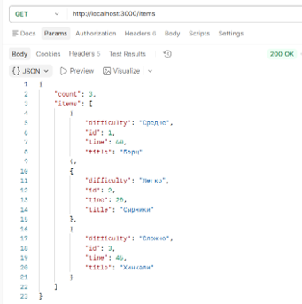 <br> <em>Рисунок 11 - Получение списка всех рецептов (GET)</em> </p>

**2. GET-запрос с параметром (Получение одного рецепта)**

<p align="center"> 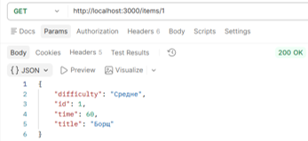 <br> <em>Рисунок 12 - Получение одного рецепта по ID</em> </p>

**2.1. Обработка ошибки 404**

<p align="center"> 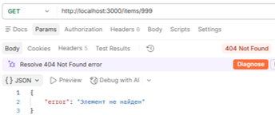 <br> <em>Рисунок 13 - Обработка ошибки 404 (рецепт не найден)</em> </p>

**3. POST-запрос (Создание рецепта)**

<p align="center"> 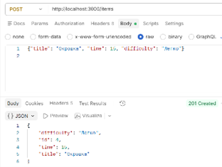 <br> <em>Рисунок 14 - Создание нового рецепта (201 Created)</em> </p>

**4. PUT-запрос (Обновление рецепта)**

<p align="center"> 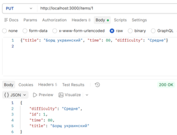 <br> <em>Рисунок 15 - Полное обновление рецепта (PUT)</em> </p>

**5. DELETE-запрос (Удаление рецепта)**

<p align="center"> 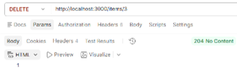 <br> <em>Рисунок 16 - Удаление рецепта с кодом 204</em> </p>

**6. PATCH-запрос (Частичное обновление)**

<p align="center"> 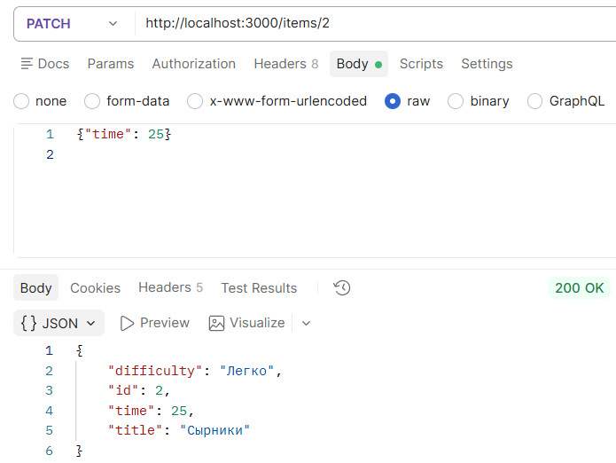 <br> <em>Рисунок 17 - Частичное обновление (изменение только времени)</em> </p>

**7. Поиск (Search)**

<p align="center"> 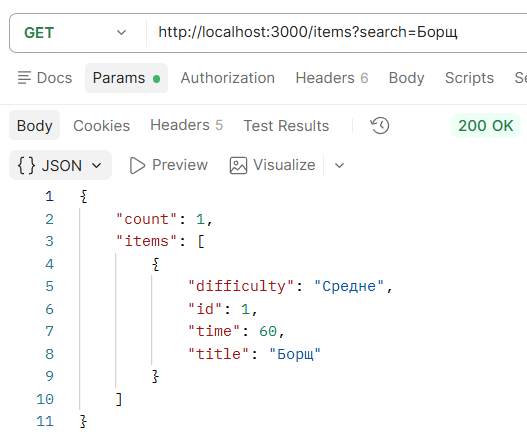 <br> <em>Рисунок 18 - Поиск по названию</em> </p>

**8. Сортировка (Sort)**

<p align="center"> 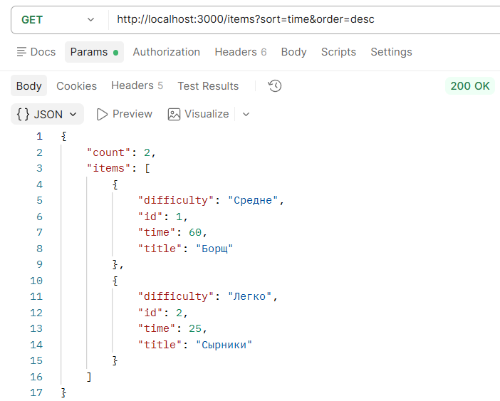 <br> <em>Рисунок 19 - Сортировка по времени</em> </p>

**9. Пагинация**

<p align="center"> 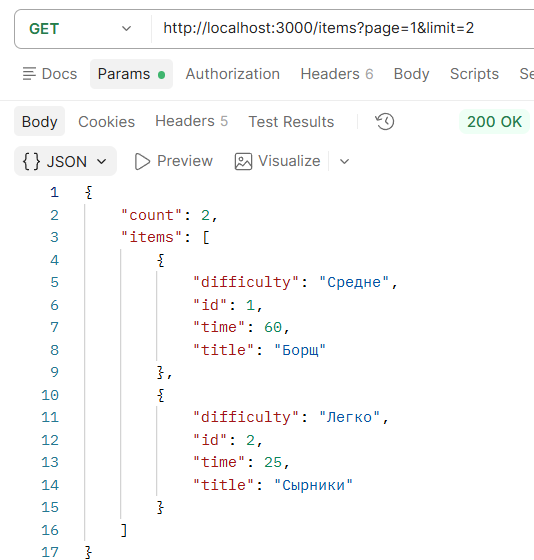 <br> <em>Рисунок 20 - Пагинация (вывод по 2 элемента)</em> </p>

**10. Статистика (Stats)**

<p align="center"> 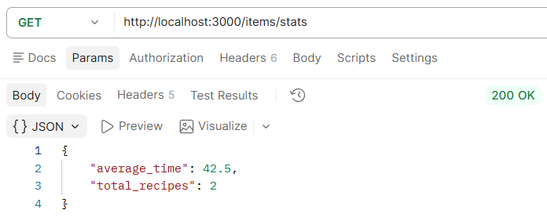 <br> <em>Рисунок 21 - Статистика (среднее время)</em> </p>

**11. Связанные элементы (Related)**

<p align="center"> 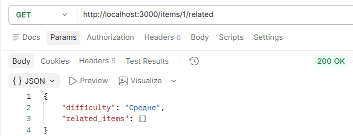 <br> <em>Рисунок 22 - Связанные элементы по сложности</em> </p>

**12. Массовое создание (Bulk)**

<p align="center"> 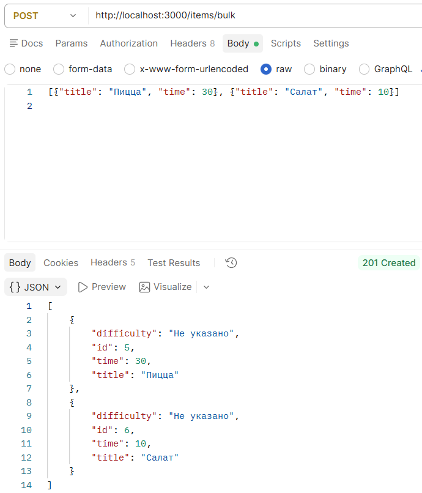 <br> <em>Рисунок 23 - Массовое создание элементов</em> </p>

**13. Обработка ошибки 400 (Bad Request)**

<p align="center"> 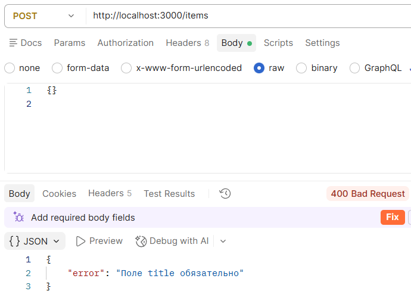 <br> <em>Рисунок 24 - Обработка ошибки 400 (неверные данные)</em> </p>

**14. Итоговая структура коллекции**

<p align="center"> 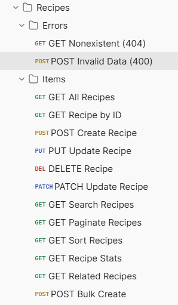 <br> <em>Рисунок 25 - Структура коллекции Postman для индивидуального задания</em> </p>

<p align="center"> 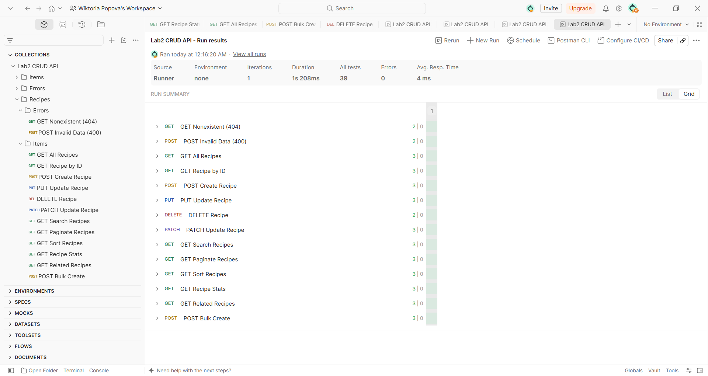 <br> <em>Рисунок 26 - Collection Runner с результатами всех тестов</em> </p>

<p align="center">  <br> <em>Рисунок 27 - GET-запрос получение всех рецептов (метод: GET, http://localhost:3000/items)</em> </p>

<p align="center"> 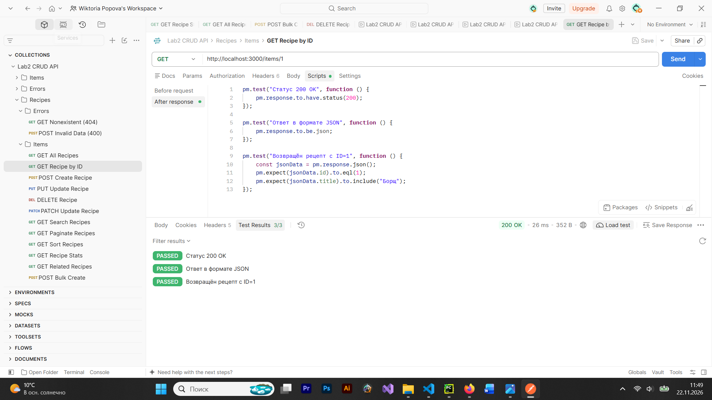 <br> <em>Рисунок 28 - GET-запрос с параметром получение одного рецепта (метод: GET, http://localhost:3000/items/1)</em> </p>

<p align="center">  <br> <em>Рисунок 29 - POST-запрос создание рецепта (метод: POST, http://localhost:3000/items)</em> </p>

<p align="center"> 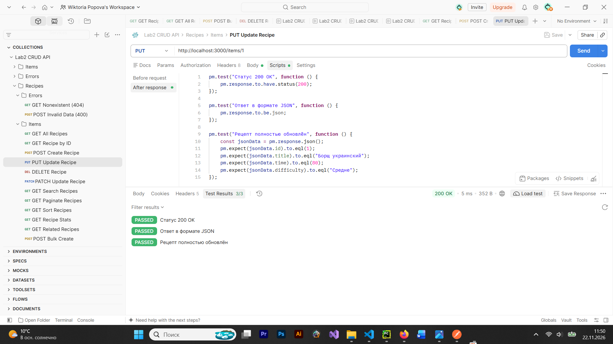 <br> <em>Рисунок 30 - PUT-запрос обновление рецепта
(метод: PUT, http://localhost:3000/items/1)</em> </p>

<p align="center"> 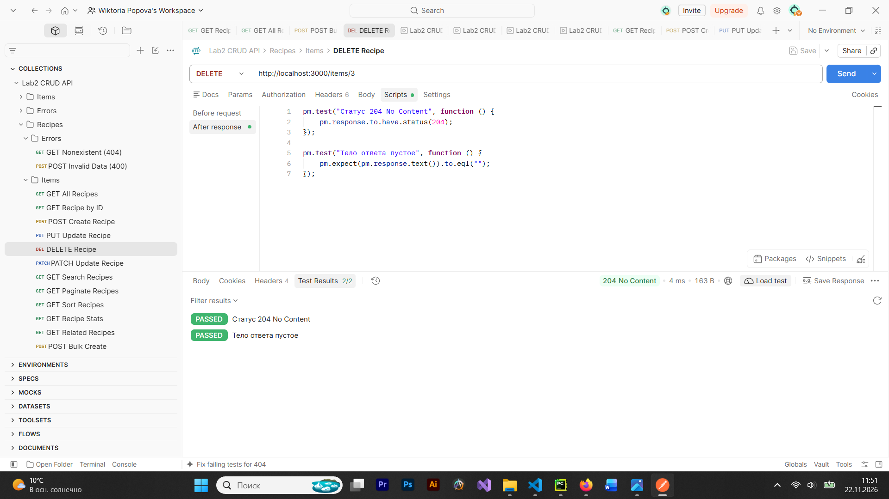 <br> <em>Рисунок 31 - DELETE-запрос удаление рецепта (метод: DELETE, http://localhost:3000/items/3)</em> </p>

<p align="center">  <br> <em>Рисунок 32 - PATCH-запрос частичное обновление (метод: PATCH, http://localhost:3000/items/2)</em> </p>

<p align="center"> 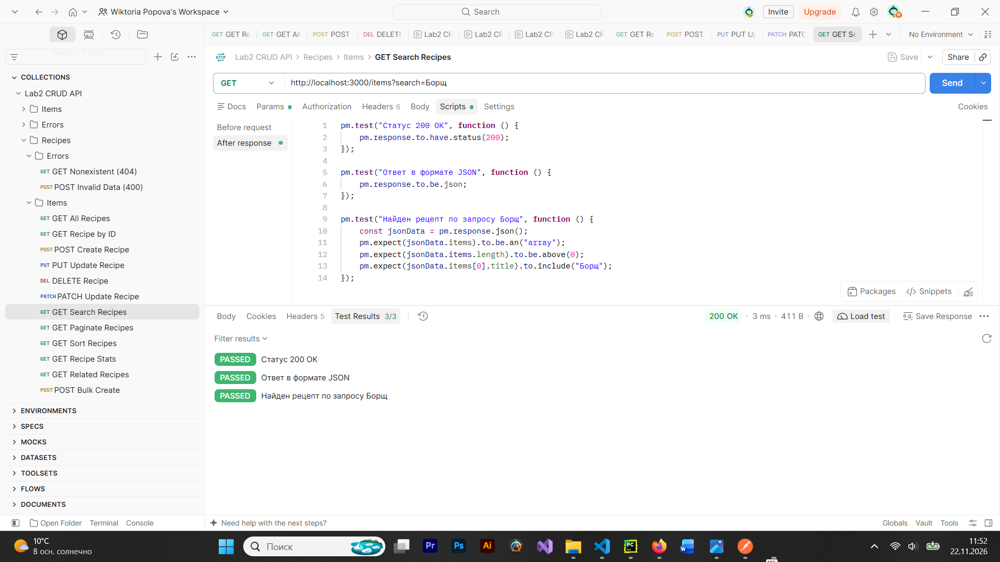 <br> <em>Рисунок 33 - Поиск (Search) (метод: GET, http://localhost:3000/items?search=Борщ)</em> </p>

<p align="center">  <br> <em>Рисунок 34 - Пагинация (метод: GET, http://localhost:3000/items?page=1&limit=2)</em> </p>

<p align="center">  <br> <em>Рисунок 35 - Сортировка (Sort) (метод: GET, http://localhost:3000/items?sort=time&order=desc)</em> </p>

<p align="center"> 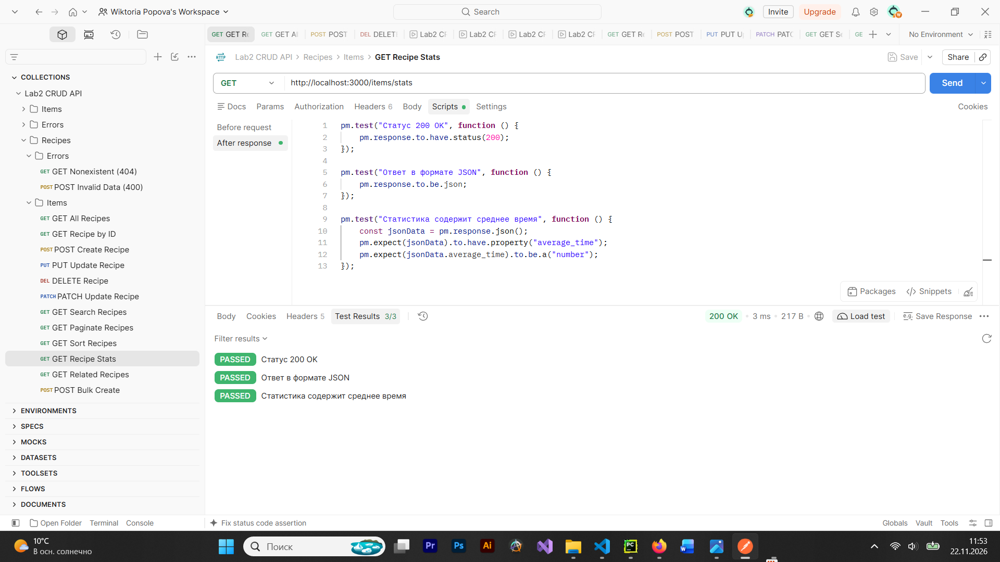 <br> <em>Рисунок 36 - Статистика (Stats )(метод: GET, http://localhost:3000/items/stats)</em> </p>

<p align="center"> 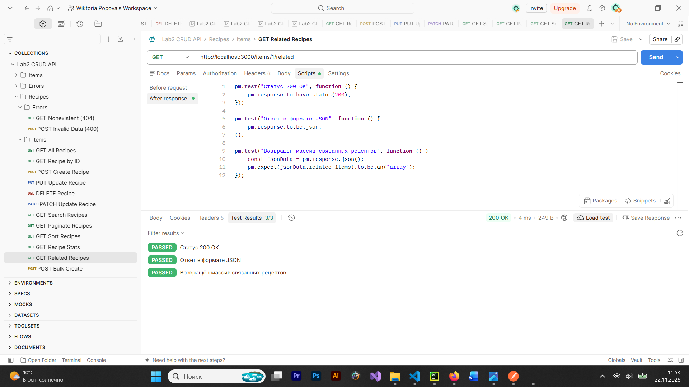 <br> <em>Рисунок 37 - Связанные элементы (Related) (метод: GET, http://localhost:3000/items/1/related)</em> </p>

<p align="center">  <br> <em>Рисунок 38 - Массовое создание (Bulk)(метод: POST, http://localhost:3000/items/bulk)</em> </p>

<p align="center"> 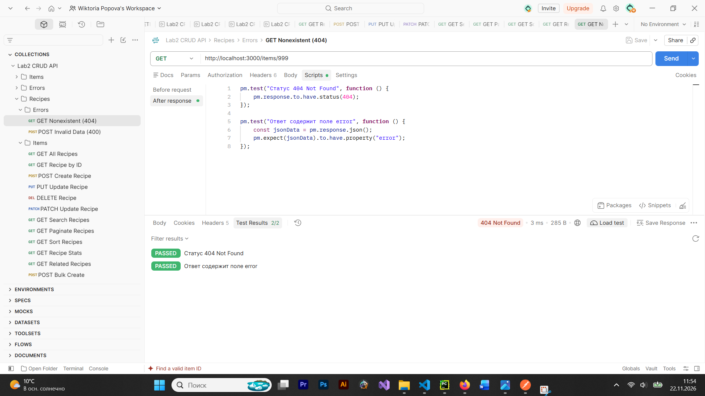 <br> <em>Рисунок 39 - Обработка ошибки 404 (метод: GET, http://localhost:3000/items/999)</em> </p>

<p align="center">  <br> <em>Рисунок 40 - Обработка ошибки 400 (Bad Request) (метод: POST, http://localhost:3000/items)</em> </p>

### 3. Ответить на контрольные вопросы

### **Контрольные вопросы (Продвинутый уровень)**

**1. Как реализовать частичное обновление (PATCH)?**

Для реализации PATCH во Flask нужно добавить метод `PATCH` в декоратор маршрута и обновлять только те поля, которые пришли в теле запроса, не трогая остальные.

```python
@app.route('/items/<int:item_id>', methods=['PATCH'])
def patch_item(item_id):
    item = next((i for i in items if i["id"] == item_id), None)
    if item is None:
        return jsonify({"error": "Элемент не найден"}), 404
    
    data = request.get_json()
    # Обновляем только те поля, которые есть в data
    for key in data:
        if key in item:
            item[key] = data[key]
            
    return jsonify(item)
```

**2. Как реализовать массовое удаление элементов?**

Нужно создать маршрут без параметров ID (например, DELETE /items), который просто очищает список в памяти.

```python
@app.route('/items', methods=['DELETE'])
def delete_all_items():
    global items
    items.clear() # Очищаем список
    return jsonify({"message": "Все элементы удалены"}), 200
```

**3. Как реализовать массовое создание элементов?**

Создается маршрут (например, POST /items/bulk), который принимает JSON-массив объектов [{...}, {...}]. В цикле каждому объекту присваивается новый ID, и он добавляется в основной список.

```python
@app.route('/items/bulk', methods=['POST'])
def create_bulk_items():
    global next_id
    data_list = request.get_json()
    new_items = []
    
    for data in data_list:
        new_item = {
            "id": next_id,
            "name": data.get('name'),
            "price": data.get('price')
        }
        items.append(new_item)
        new_items.append(new_item)
        next_id += 1
        
    return jsonify(new_items), 201
```

**4. Как реализовать глобальный обработчик ошибок?**

Во Flask используется декоратор @app.errorhandler(Exception). Он перехватывает любые непредвиденные ошибки (код 500) и возвращает красивый JSON вместо стандартной HTML-страницы с трейсбеком.

```python
@app.errorhandler(Exception)
def handle_exception(e):
    return jsonify({"error": "Внутренняя ошибка сервера"}), 500
```

**5. Как логировать запросы в файл?**

В Python для этого используется встроенный модуль logging. Настраиваем его один раз при старте приложения, а затем вызываем в декораторе @app.before_request.

```python
import logging

logging.basicConfig(filename='access.log', level=logging.INFO, 
                    format='%(asctime)s - %(message)s')


@app.before_request
def log_request():
    logging.info(f"{request.method} {request.path}")
```

**6. Что такое REST API и какие принципы лежат в его основе?**

REST API (Representational State Transfer) — это архитектурный стиль для создания веб-сервисов. Его основные принципы:

- Клиент-серверная архитектура: разделение интерфейса и хранения данных.

- Отсутствие состояния (Stateless): каждый запрос независим, сервер не хранит сессию клиента.

- Кэширование: ответы могут кэшироваться для ускорения работы.

- Единообразие интерфейса: использование стандартных HTTP-методов (GET, POST, PUT, DELETE) и URL для идентификации ресурсов.

**7. Как организовать структуру проекта для масштабируемого CRUD API?**

Для больших проектов код разбивают на модули с помощью Blueprint (Чертежей) Flask:

- app/__init__.py — инициализация приложения.

- app/routes/items.py — маршруты для одной сущности.

- app/routes/users.py — маршруты для другой.

- app/models.py — описание структур данных (или база данных).

- config.py — настройки.

Это позволяет не держать весь код в одном файле app.py.

**8. Какие существуют стратегии генерации уникальных ID?**

1. Автоинкремент (Счётчик): next_id += 1 (как в лабораторной). Просто, но не подходит для распределенных систем.

2. UUID (Universally Unique Identifier): генерация случайной длинной строки (например, 550e8400-e29b-41d4-a716-446655440000). Гарантирует уникальность даже на разных серверах.

3. Генерация на основе времени (Timestamp): использование текущего времени в миллисекундах с добавлением случайного числа.

**9. Как защитить API от слишком больших запросов?**

Во Flask можно ограничить максимальный размер входящего запроса (тела) с помощью настройки MAX_CONTENT_LENGTH. Если клиент отправит данные больше этого размера, сервер вернет ошибку 413 Request Entity Too Large.

```python
app.config['MAX_CONTENT_LENGTH'] = 1 * 1024 * 1024 # Ограничение 1 Мегабайт
```

**10. Как реализовать связь между сущностями (например, задачи и пользователи)?**

Связь реализуется через внешний ключ (foreign key). В JSON-объекте задачи добавляется поле с ID пользователя:

```json
{
  "id": 1,
  "title": "Сделать лабораторную работу",
  "user_id": 5 
}
```

Тогда, чтобы получить все задачи конкретного пользователя, создается эндпоинт вида GET /users/5/tasks, который фильтрует список задач по user_id == 5.

## Вывод

В ходе выполнения лабораторной работы была освоена обработка HTTP-методов (`GET`, `POST`, `PUT`, `DELETE`, а также `PATCH` для продвинутого уровня) с использованием фреймворка **Python + Flask**. Получены навыки реализации полноценных **CRUD-операции** над коллекцией объектов, которая хранится в оперативной памяти сервера (в виде списков Python). 

Кроме того, было изучено формирование корректных **HTTP-кодов ответов**:
*   `200 OK` — при успешном получении данных или обновлении;
*   `201 Created` — при успешном создании нового ресурса;
*   `204 No Content` — при успешном удалении;
*   `404 Not Found` — при запросе несуществующего элемента;
*   `400 Bad Request` — при ошибках валидации входных данных.

В рамках индивидуального задания был реализован продвинутый уровень API для сущности «Рецепты». Были добавлены функции: поиск по названию, сортировка, пагинация, частичное обновление (`PATCH`), массовое создание и удаление элементов, а также дополнительные эндпоинты для получения статистики (среднее время) и связанных элементов. Также был настроен глобальный обработчик ошибок `500` и логирование запросов в файл `access.log`.

Отдельно освоена работа с инструментом **Postman**: создание коллекции, отправка запросов с JSON-телом, передача параметров в URL (Query Params) и анализ ответов сервера. 

## Список использованных источников
1. **Flask официальная документация** — https://flask.palletsprojects.com/
2. **HTTP-методы (MDN)** — https://developer.mozilla.org/ru/docs/Web/HTTP/Methods
3. **Коды состояния HTTP (MDN)** — https://developer.mozilla.org/ru/docs/Web/HTTP/Status
4. **Postman Learning Center** — https://learning.postman.com/