# Лабораторная работа №3: Маршрутизация, параметры пути и query-параметры

**Студент:** Попова Виктория Романовна
**Группа:** ПИЖ-б-о-25-1(1)
**Вариант:** 11
**Технология:** Python + Flask

## Содержание
- [Цель работы](#цель-работы)
- [Теоретическое обоснование](#теоретическое-обоснование)
- [Выполнение практического примера](#выполнение-практического-примера)
- [Выполнение индивидуального задания](#выполнение-индивидуального-задания)
- [Контрольные вопросы](#контрольные-вопросы)
- [Вывод](#вывод)
- [Список использованных источников](#список-использованных-источников)

## Цель работы
Освоить различные способы передачи данных через URL. Научиться строить гибкие маршруты с параметрами пути и query-параметрами, комбинировать их, обрабатывать вложенные ресурсы и валидировать входные данные. Понять разницу между параметрами пути (path params), query-параметрами и телом запроса.

## Теоретическое обоснование

### *1. Что такое маршрутизация*
**Маршрутизация (routing)** — это механизм сопоставления HTTP-запроса (метод + URL) с кодом-обработчиком на сервере. Каждый маршрут определяет, какой код выполнится при обращении клиента по конкретному адресу. Во Flask маршрут задаётся декоратором `@app.route('/path', methods=['GET'])` над функцией-обработчиком.

### *2. Три источника данных в запросе*
При обработке запроса сервер может получать данные из трёх мест:
- **Параметры пути** — находятся в самом URL (например, `/users/42`). Во Flask задаются как `<int:user_id>`.
- **Query-параметры** — передаются после знака `?` (например, `/users?age=20`). Во Flask извлекаются через `request.args.get('age')`.
- **Тело запроса** — передаётся отдельно, используется для методов `POST`, `PUT`, `PATCH`. Во Flask извлекается через `request.get_json()`.

### *3. Параметры пути и query-параметры*
- **Параметры пути** используются для идентификации конкретного ресурса. Например: `GET /recipes/5` (получить рецепт с ID 5). Во Flask мы указываем тип, чтобы автоматически отсеивать неверные запросы: `<int:recipe_id>`.
- **Query-параметры** используются для фильтрации, сортировки и пагинации. Например: `GET /recipes?search=Борщ&sort=time`.

### *4. Вложенные маршруты и Wildcard*
- **Вложенные маршруты** отражают иерархию ресурсов (например, шаги конкретного рецепта: `/recipes/5/steps`).
- **Wildcard-маршруты** (обработчик 404) перехватывают все запросы, которые не совпали ни с одним из объявленных маршрутов. Во Flask реализуется через `@app.errorhandler(404)`.

### *5. Валидация параметров*
Параметры из URL всегда приходят в виде строк. Поэтому важно проверять их типы. Если в URL передать букву вместо ID (`/recipes/abc`), Flask автоматически выдаст 400 Bad Request, если в маршруте указан тип `<int:recipe_id>`. Дополнительно настраивается валидация query-параметров (например, `limit` не должен превышать 100).

## Ход выполнения лабораторной работы
### 1. Выполнение практического примера

В качестве практического примера реализован сервер для работы с городами (`cities`).

**Код сервера (`practical3.py`):**

```python
from flask import Flask, jsonify, request
import time

app = Flask(__name__)

@app.before_request
def log_request():
    print(f"[{time.strftime('%Y-%m-%d %H:%M:%S')}] {request.method} {request.path}")

cities = [
    {"id": 1, "name": "Москва", "population": 13000000, "country": "Россия", "area": 2561},
    {"id": 2, "name": "Санкт-Петербург", "population": 5600000, "country": "Россия", "area": 1439},
    {"id": 3, "name": "Новосибирск", "population": 1600000, "country": "Россия", "area": 505},
    {"id": 4, "name": "Екатеринбург", "population": 1500000, "country": "Россия", "area": 1112},
    {"id": 5, "name": "Казань", "population": 1250000, "country": "Россия", "area": 425}
]

# БАЗОВЫЙ УРОВЕНЬ

@app.route('/cities')
def get_cities():
    return jsonify({"count": len(cities), "cities": cities})

@app.route('/cities/<int:city_id>')
def get_city(city_id):
    city = next((c for c in cities if c["id"] == city_id), None)
    if not city:
        return jsonify({"error": "Город не найден"}), 404
    return jsonify(city)

@app.route('/cities/<int:city_id>/area')
def get_city_area(city_id):
    city = next((c for c in cities if c["id"] == city_id), None)
    if not city:
        return jsonify({"error": "Город не найден"}), 404
    return jsonify({"city": city["name"], "area": city["area"], "unit": "км²"})

@app.route('/countries/<string:country>/cities')
def get_country_cities(country):
    filtered = [c for c in cities if c["country"].lower() == country.lower()]
    return jsonify({"country": country, "count": len(filtered), "cities": filtered})

# СРЕДНИЙ УРОВЕНЬ (Поиск, сортировка, пагинация)

@app.route('/cities/search')
def search_cities():
    result = list(cities)
    
    search = request.args.get('search')
    if search:
        result = [c for c in result if search.lower() in c["name"].lower()]
        
    country = request.args.get('country')
    if country:
        result = [c for c in result if c["country"].lower() == country.lower()]
        
    sort = request.args.get('sort')
    order = request.args.get('order', 'asc')
    
    if sort:
        allowed = ['id', 'name', 'population', 'area']
        if sort not in allowed:
            return jsonify({"error": f"sort должен быть одним из: {allowed}"}), 400
        if order not in ['asc', 'desc']:
            return jsonify({"error": "order должен быть asc или desc"}), 400
        result.sort(key=lambda x: x[sort], reverse=(order == 'desc'))
        
    page = request.args.get('page', 1, type=int)
    limit = request.args.get('limit', 10, type=int)
    
    if page < 1:
        return jsonify({"error": "page должен быть >= 1"}), 400
    if limit < 1 or limit > 100:
        return jsonify({"error": "limit должен быть от 1 до 100"}), 400
        
    start = (page - 1) * limit
    end = start + limit
    paginated = result[start:end]
    
    return jsonify({
        "count": len(result),
        "page": page,
        "limit": limit,
        "totalPages": (len(result) + limit - 1) // limit,
        "cities": paginated
    })

# ПРОДВИНУТЫЙ УРОВЕНЬ (Вложенные)

@app.route('/cities/<int:city_id>/details')
def get_city_details(city_id):
    city = next((c for c in cities if c["id"] == city_id), None)
    if not city:
        return jsonify({"error": "Город не найден"}), 404
        
    districts = [
        {"id": 1, "name": "Центральный", "cityId": city_id},
        {"id": 2, "name": "Северный", "cityId": city_id}
    ]
    return jsonify({"city": city, "districts": districts, "attractions": ["Кремль", "Парк", "Музей"]})

@app.route('/countries/<string:country>/cities/<int:city_id>')
def get_country_city(country, city_id):
    city = next((c for c in cities if c["id"] == city_id and c["country"].lower() == country.lower()), None)
    if not city:
        return jsonify({"error": f"Город с ID={city_id} не найден в стране {country}"}), 404
    return jsonify({"country": country, "city": city})

# ОБРАБОТКА 404
@app.errorhandler(404)
def not_found(error):
    return jsonify({"error": "Маршрут не найден"}), 404

if __name__ == '__main__':
    app.run(port=3000, debug=True)
```

### Проверка в Postman для практического примера (Города)

**1. Получение всех городов**

<p align="center"> 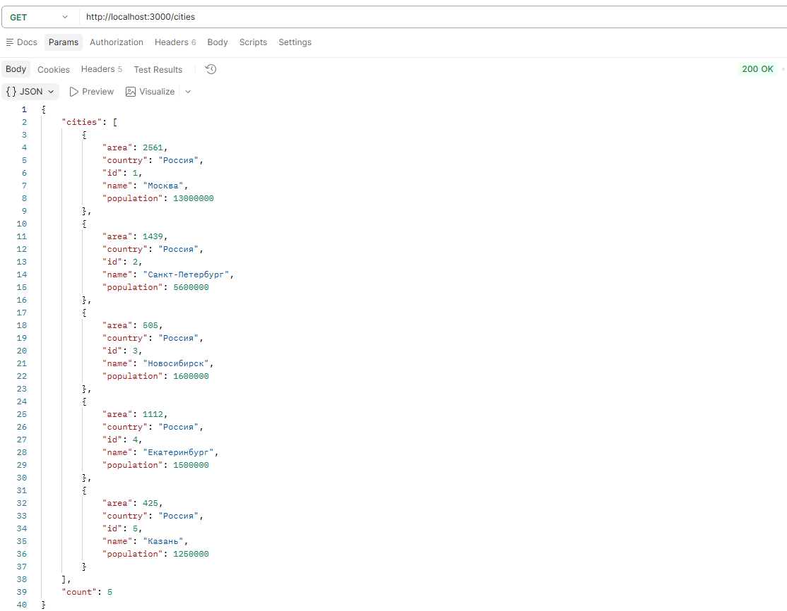 <br> <em>Рисунок 1 - Получение списка всех городов</em> </p>

**2. Получение одного города**

<p align="center"> 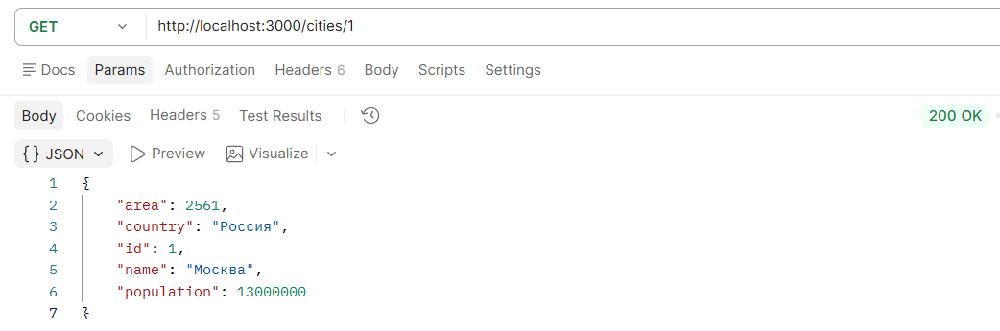 <br> <em>Рисунок 2 - Получение города по ID</em> </p>

**3. Обработка 404 (Несуществующий город)**

<p align="center"> 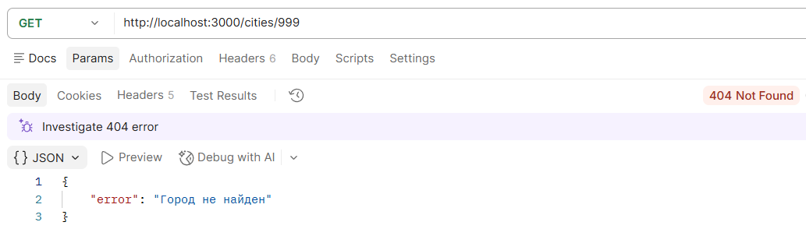 <br> <em>Рисунок 3 - Обработка ошибки 404</em> </p>

**4. Обработка 400 (Неверный тип ID)**

<p align="center"> 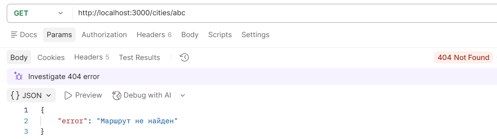 <br> <em>Рисунок 4 - Обработка неверного типа данных</em> </p>

**5. Площадь города**

<p align="center"> 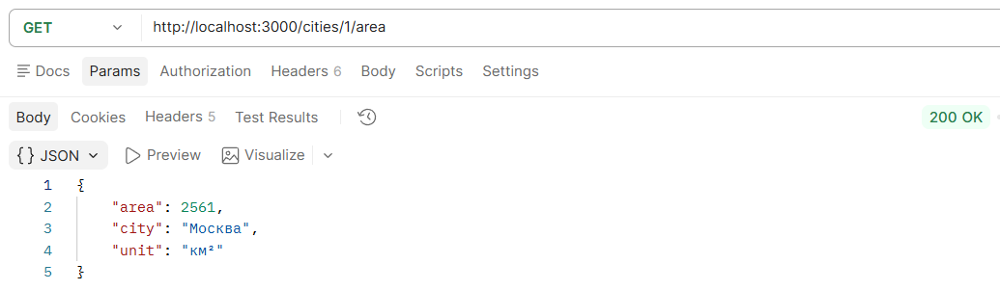 <br> <em>Рисунок 5 - Получение площади города</em> </p>

**6. Города страны**

<p align="center"> 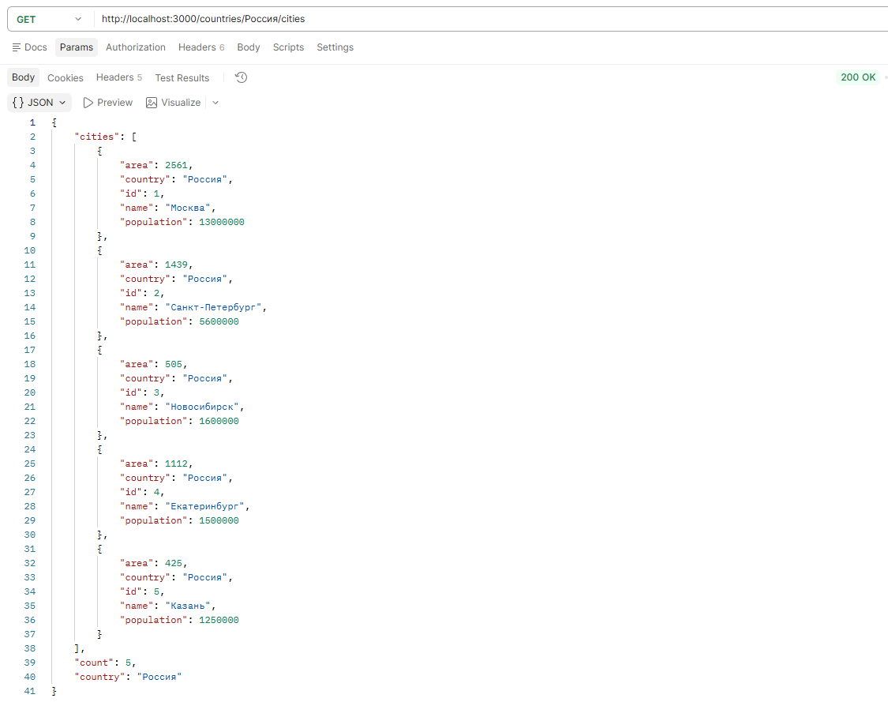 <br> <em>Рисунок 6 - Получение городов по стране</em> </p>

**7. Поиск**

<p align="center"> 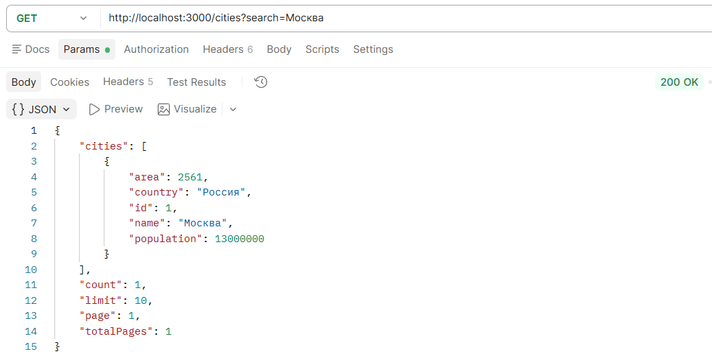 <br> <em>Рисунок 7 - Поиск по названию</em> </p>

**8. Сортировка**

<p align="center"> 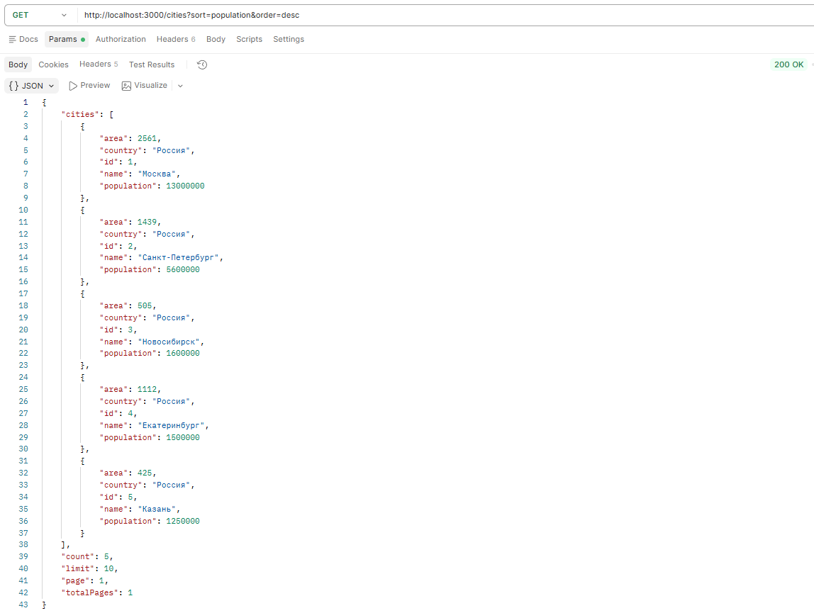 <br> <em>Рисунок 8 - Сортировка по населению</em> </p>

**9. Пагинация**

<p align="center"> 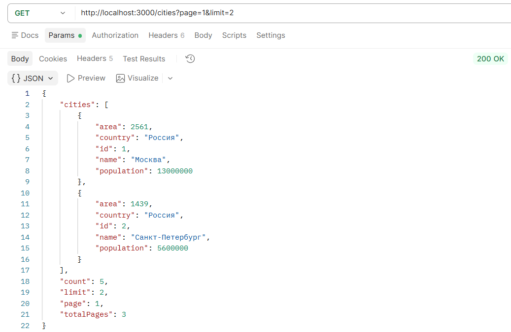 <br> <em>Рисунок 9 - Пагинация (по 2 элемента)</em> </p>

**10. Детали с вложенными**

<p align="center"> 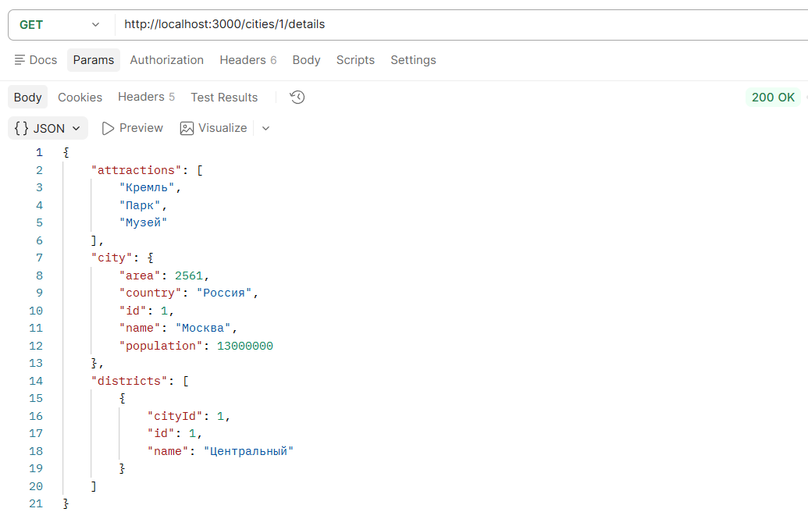 <br> <em>Рисунок 10 - Детальная информация с вложенными данными</em> </p>

**11. Город в стране**

<p align="center"> 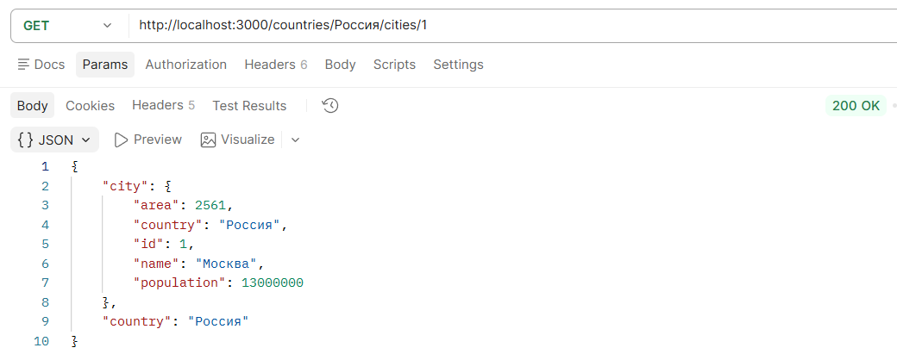 <br> <em>Рисунок 11 - Получение конкретного города в стране</em> </p>

**12. Обработка 404 (Несуществующий маршрут)**

<p align="center"> 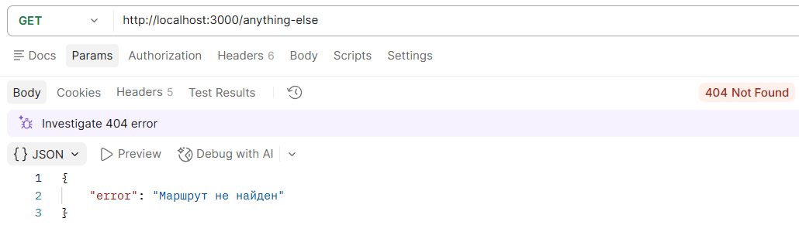 <br> <em>Рисунок 12 - Обработка несуществующего маршрута (404)</em> </p>

### Выполнение индивидуального задания (Вариант 11, Продвинутый уровень)

**Код сервера (`lab3-backend.py`):**

```python
from flask import Flask, jsonify, request
import time

app = Flask(__name__)

# Данные (Рецепты)
recipes = [
    {"id": 1, "title": "Борщ", "time": 60, "difficulty": "Средне"},
    {"id": 2, "title": "Сырники", "time": 20, "difficulty": "Легко"},
    {"id": 3, "title": "Хинкали", "time": 90, "difficulty": "Сложно"},
    {"id": 4, "title": "Окрошка", "time": 15, "difficulty": "Легко"},
    {"id": 5, "title": "Пельмени", "time": 50, "difficulty": "Средне"}
]


@app.before_request
def log_request():
    print(f"[{time.strftime('%Y-%m-%d %H:%M:%S')}] {request.method} {request.path} | IP: {request.remote_addr}")


# БАЗОВЫЙ УРОВЕНЬ

# 1. Все рецепты + Средний уровень (Поиск, сортировка, пагинация)
@app.route('/recipes')
def get_recipes():
    result = list(recipes)

    # Поиск по названию
    search = request.args.get('search')
    if search:
        result = [r for r in result if search.lower() in r["title"].lower()]

    # Фильтр по сложности
    difficulty = request.args.get('difficulty')
    if difficulty:
        result = [r for r in result if r["difficulty"].lower() == difficulty.lower()]

    # Сортировка
    sort = request.args.get('sort')
    order = request.args.get('order', 'asc')

    if sort:
        allowed = ['id', 'title', 'time']
        if sort not in allowed:
            return jsonify({"error": f"sort должен быть одним из: {allowed}"}), 400
        if order not in ['asc', 'desc']:
            return jsonify({"error": "order должен быть asc или desc"}), 400
        result.sort(key=lambda x: x[sort], reverse=(order == 'desc'))

    # Пагинация
    page = request.args.get('page', 1, type=int)
    limit = request.args.get('limit', 10, type=int)

    if page < 1:
        return jsonify({"error": "page должен быть >= 1"}), 400
    if limit < 1 or limit > 100:
        return jsonify({"error": "limit должен быть от 1 до 100"}), 400

    start = (page - 1) * limit
    end = start + limit
    paginated = result[start:end]

    return jsonify({
        "count": len(result),
        "page": page,
        "limit": limit,
        "totalPages": (len(result) + limit - 1) // limit,
        "recipes": paginated
    })


# 2. Один рецепт по ID
@app.route('/recipes/<recipe_id>')
def get_recipe(recipe_id):
    if not recipe_id.isdigit():
        return jsonify({"error": "ID должен быть числом"}), 400

    rid = int(recipe_id)
    recipe = next((r for r in recipes if r["id"] == rid), None)
    if not recipe:
        return jsonify({"error": "Рецепт не найден"}), 404
    return jsonify(recipe)


# 3. Вложенный ресурс: шаги рецепта
@app.route('/recipes/<recipe_id>/steps')
def get_recipe_steps(recipe_id):
    if not recipe_id.isdigit():
        return jsonify({"error": "ID должен быть числом"}), 400

    rid = int(recipe_id)
    recipe = next((r for r in recipes if r["id"] == rid), None)
    if not recipe:
        return jsonify({"error": "Рецепт не найден"}), 404

    steps = [
        {"step": 1, "description": "Подготовить ингредиенты"},
        {"step": 2, "description": "Приготовить блюдо"},
        {"step": 3, "description": "Подать на стол"}
    ]
    return jsonify({"recipe": recipe["title"], "steps": steps})


# 4. Элементы категории: рецепты по сложности
@app.route('/difficulties/<string:diff>/recipes')
def get_recipes_by_difficulty(diff):
    filtered = [r for r in recipes if r["difficulty"].lower() == diff.lower()]
    return jsonify({"difficulty": diff, "count": len(filtered), "recipes": filtered})


# ПРОДВИНУТЫЙ УРОВЕНЬ

# 5. Детальная информация с вложенными данными
@app.route('/recipes/<recipe_id>/details')
def get_recipe_details(recipe_id):
    if not recipe_id.isdigit():
        return jsonify({"error": "ID должен быть числом"}), 400

    rid = int(recipe_id)
    recipe = next((r for r in recipes if r["id"] == rid), None)
    if not recipe:
        return jsonify({"error": "Рецепт не найден"}), 404

    ingredients = ["Картофель", "Мясо", "Свекла", "Капуста"] if recipe["title"] == "Борщ" else ["Ингредиент 1",
                                                                                                "Ингредиент 2"]

    return jsonify({
        "recipe": recipe,
        "ingredients": ingredients,
        "tips": ["Совет 1", "Совет 2"]
    })


# 6. Конкретный рецепт в конкретной категории сложности
@app.route('/difficulties/<string:diff>/recipes/<recipe_id>')
def get_recipe_in_difficulty(diff, recipe_id):
    if not recipe_id.isdigit():
        return jsonify({"error": "ID должен быть числом"}), 400

    rid = int(recipe_id)
    recipe = next((r for r in recipes if r["id"] == rid and r["difficulty"].lower() == diff.lower()), None)
    if not recipe:
        return jsonify({"error": f"Рецепт с ID={recipe_id} не найден в категории {diff}"}), 404
    return jsonify({"difficulty": diff, "recipe": recipe})


# 7. Статистика по коллекции
@app.route('/recipes/stats')
def get_recipes_stats():
    if not recipes:
        return jsonify({"count": 0, "avg_time": 0, "min_time": 0, "max_time": 0})

    times = [r["time"] for r in recipes]
    return jsonify({
        "count": len(recipes),
        "avg_time": round(sum(times) / len(times), 2),
        "min_time": min(times),
        "max_time": max(times)
    })


# ОБРАБОТКА ОШИБОК

# Обработка 404 (Wildcard-маршрут)
@app.errorhandler(404)
def not_found(error):
    return jsonify({"error": "Маршрут не найден"}), 404


# Обработка 500 (Глобальный обработчик ошибок)
@app.errorhandler(500)
def internal_error(error):
    return jsonify({"error": "Внутренняя ошибка сервера"}), 500


if __name__ == '__main__':
    app.run(port=3000, debug=True)
```

### Проверка в Postman для индивидуального задания (Рецепты)

**1. GET-запрос (Все рецепты)**

<p align="center"> 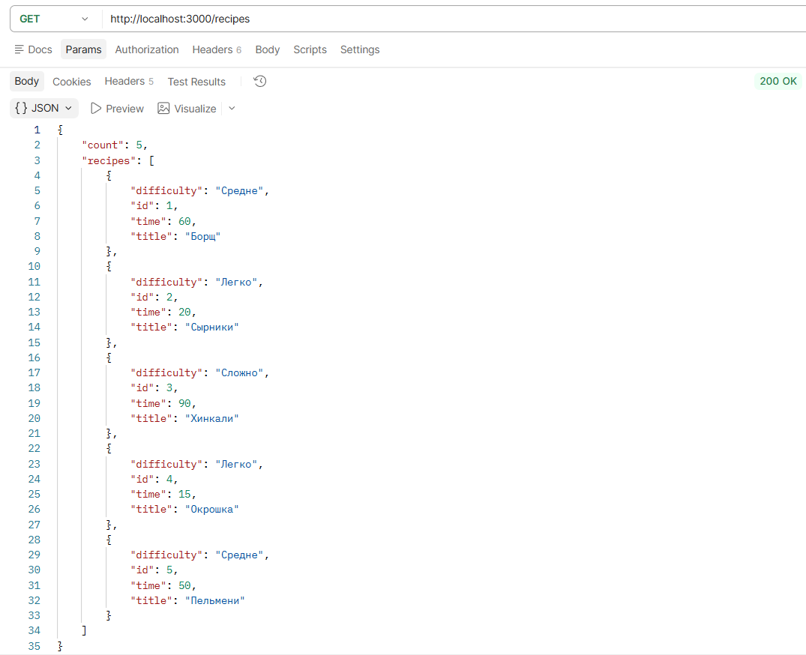 <br> <em>Рисунок 13 - Список всех рецептов</em> </p>

**2. GET-запрос (Один рецепт по ID)**

<p align="center"> 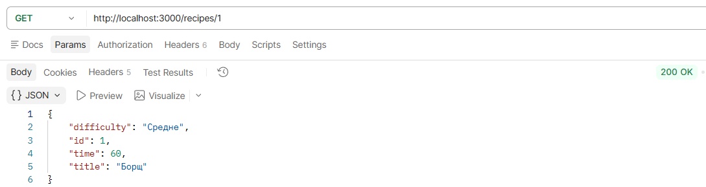 <br> <em>Рисунок 14 - Получение одного рецепта</em> </p>

**3. Вложенный ресурс (Шаги рецепта)**

<p align="center"> 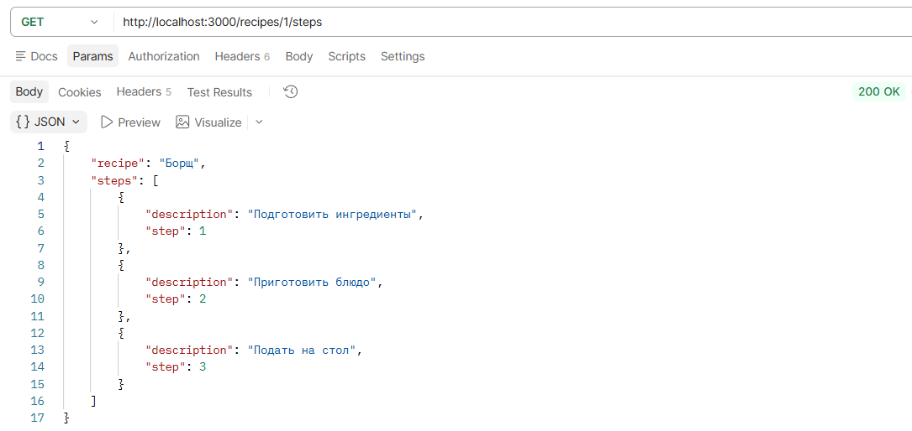 <br> <em>Рисунок 15 - Вложенный ресурс (шаги)</em> </p>

**4. Элементы категории (Рецепты по сложности)**

<p align="center"> 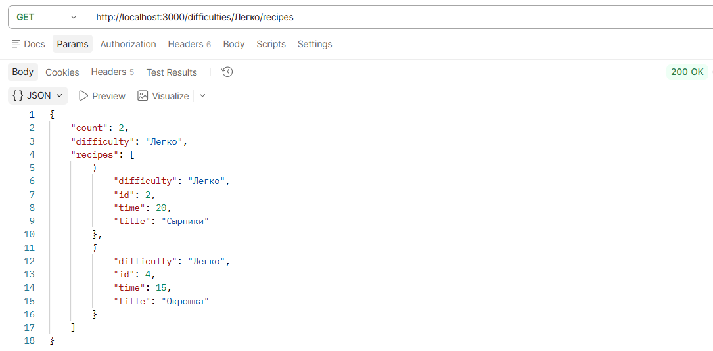 <br> <em>Рисунок 16 - Рецепты по сложности</em> </p>

**5. Поиск, сортировка, пагинация (Query-параметры)**

<p align="center"> 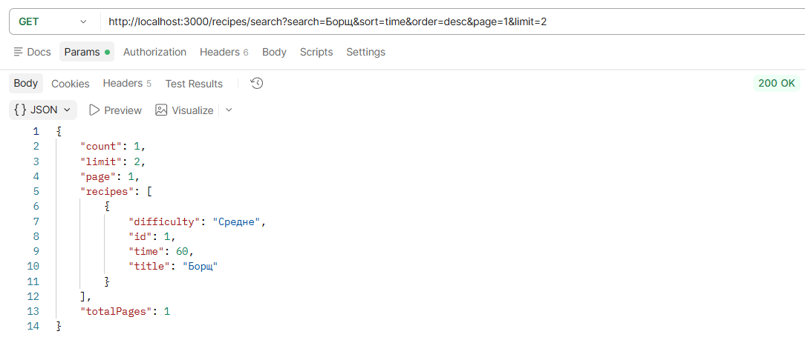 <br> <em>Рисунок 17 - Поиск, сортировка и пагинация</em> </p>

**6. Детальная информация (Вложенные данные)**

<p align="center"> 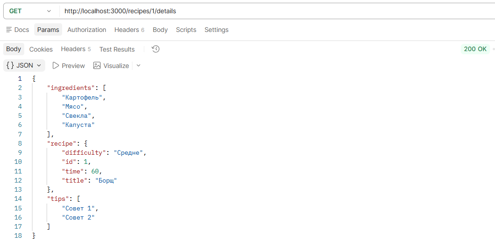 <br> <em>Рисунок 18 - Детальная информация</em> </p>

**7. Конкретный рецепт в категории (Двойная фильтрация)**

<p align="center"> 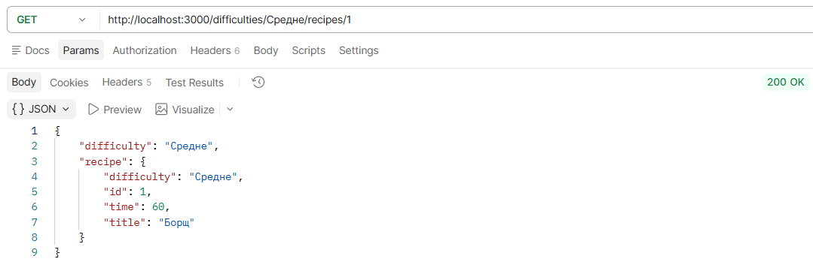 <br> <em>Рисунок 19 - Рецепт в категории сложности</em> </p>

**8. Обработка ошибки 404 (Несуществующий рецепт)**

<p align="center"> 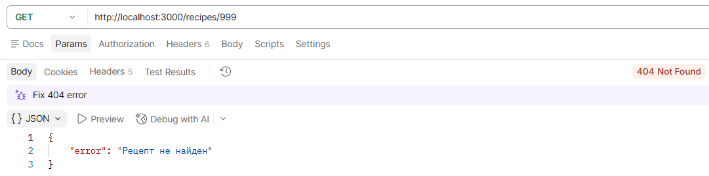 <br> <em>Рисунок 20 - Ошибка 404 (рецепт не найден)</em> </p>

**9. Обработка ошибки 400 (Неверный ID)**

<p align="center"> 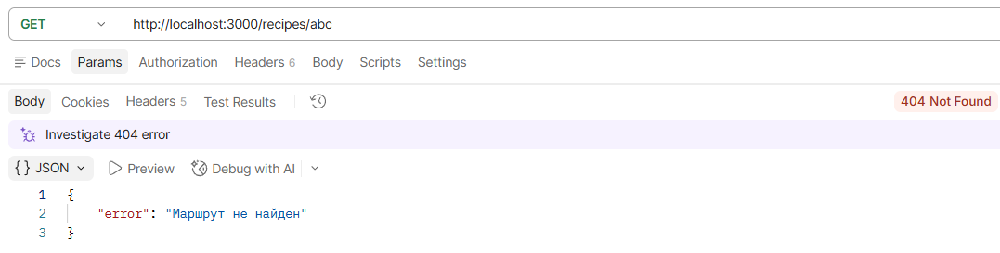 <br> <em>Рисунок 21 - Ошибка 400 (неверный тип данных)</em> </p>

**10. Итоговая структура коллекции**

<p align="center"> 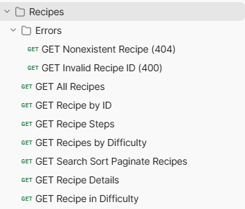 <br> <em>Рисунок 22 - Структура коллекции Postman для 3 лабы</em> </p>

<p align="center"> 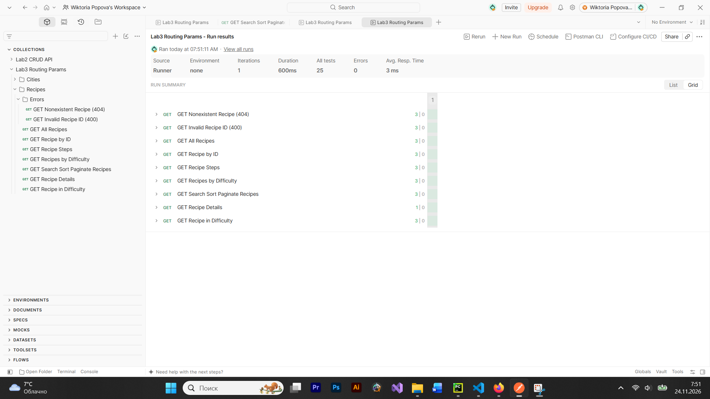 <br> <em>Рисунок 23 - Collection Runner с результатами всех тестов</em> </p>

### 3. Ответить на контрольные вопросы

### **Контрольные вопросы (Продвинутый уровень)**

**20. Как комбинировать параметры пути и query-параметры в одном запросе?**
Параметры пути используются для идентификации конкретного ресурса, а query-параметры — для модификации ответа (фильтрации, сортировки, пагинации). Во Flask параметр пути передается как аргумент функции, а query-параметры извлекаются через request.args.

```python
@app.route('/recipes/<int:recipe_id>/steps')
def get_recipe_steps(recipe_id):
    # Query-параметр для сортировки шагов (например, ?sort=asc)
    sort_order = request.args.get('sort', 'asc')
    # Логика получения и сортировки шагов для recipe_id
    return jsonify({"recipe_id": recipe_id, "sort": sort_order, "steps": []})
```

**21. Как реализовать вложенные маршруты с несколькими уровнями?**
Вложенные маршруты отражают иерархию данных. Во Flask это реализуется путем указания нескольких переменных в декораторе @app.route, которые затем передаются как аргументы в функцию-обработчик.

```python
@app.route('/users/<int:user_id>/recipes/<int:recipe_id>/comments/<int:comment_id>')
def get_comment(user_id, recipe_id, comment_id):
    # Логика получения конкретного комментария к рецепту пользователя
    return jsonify({
        "user_id": user_id,
        "recipe_id": recipe_id,
        "comment_id": comment_id,
        "text": "Отличный рецепт!"
    })
```

**22. Как обработать wildcard-маршрут и почему он должен быть последним?**
Wildcard-маршрут (или обработчик 404) перехватывает все запросы, которые не совпали ни с одним из объявленных маршрутов. Он должен быть объявлен последним, иначе он перехватит все входящие запросы, и специфичные маршруты никогда не выполнятся.

```python
@app.errorhandler(404)
def not_found(error):
    return jsonify({"error": "Маршрут не найден"}), 404
```

**23. Как реализовать глобальный обработчик ошибок?**
Используется декоратор @app.errorhandler(Exception). Он перехватывает любые непредвиденные ошибки (код 500) и возвращает клиенту корректный JSON-ответ вместо стандартной HTML-страницы с трейсбеком.

```python
@app.errorhandler(Exception)
def handle_exception(e):
    return jsonify({"error": "Внутренняя ошибка сервера"}), 500
```

**24. Как логировать все запросы с IP-адресом клиента?**
Используется декоратор @app.before_request, который выполняется перед каждым запросом. IP-адрес клиента доступен в объекте request как request.remote_addr.

```python
import logging
import time

logging.basicConfig(filename='access.log', level=logging.INFO, 
                    format='%(asctime)s - %(message)s')

@app.before_request
def log_request():
    ip = request.remote_addr
    logging.info(f"[{time.strftime('%Y-%m-%d %H:%M:%S')}] {request.method} {request.path} | IP: {ip}")
```

**25. Как защитить API от слишком больших значений limit?**
Необходимо валидировать query-параметр limit на сервере, устанавливая жесткое максимальное пороговое значение (например, 100). Если переданное значение превышает лимит, возвращается ошибка 400 Bad Request.

```python
@app.route('/recipes')
def get_recipes():
    limit = request.args.get('limit', 10, type=int)
    if limit < 1 or limit > 100:
        return jsonify({"error": "limit должен быть от 1 до 100"}), 400
    # Дальнейшая логика пагинации
```

**26. Как реализовать статистику по коллекции?**
Создается отдельный эндпоинт, который вычисляет агрегированные данные по всей коллекции: общее количество, среднее значение, минимум и максимум по числовым полям.

```python
@app.route('/recipes/stats')
def get_recipes_stats():
    if not recipes:
        return jsonify({"count": 0, "avg_time": 0})
    
    count = len(recipes)
    total_time = sum(r.get('time', 0) for r in recipes)
    
    return jsonify({
        "count": count,
        "avg_time": round(total_time / count, 2),
        "min_time": min(r.get('time', 0) for r in recipes),
        "max_time": max(r.get('time', 0) for r in recipes)
    })
```

**27. Как организовать структуру проекта при росте числа маршрутов?**
Для больших проектов код разбивают на модули с помощью Blueprint (Чертежей) во Flask. Это позволяет изолировать маршруты, модели и логику разных сущностей в отдельных файлах.

- app/__init__.py — инициализация приложения и регистрация blueprint.
- app/routes/recipes.py — маршруты для рецептов.
- app/routes/users.py — маршруты для пользователей.
- app/models.py — описание структур данных.
- config.py — настройки приложения.

**28. Как документировать параметры маршрутов (OpenAPI/Swagger)?**
Используются библиотеки для автоматической генерации документации, например, Flasgger или Flask-RESTX. Документация описывается через декораторы или YAML-файлы, где указываются типы данных, обязательность и описание каждого параметра пути и query-параметра.

```python
from flasgger import Swagger

app.config['SWAGGER'] = {'title': 'Recipes API', 'uiversion': 3}
swagger = Swagger(app)

@app.route('/recipes/<int:recipe_id>')
@swag_from({
    'parameters': [
        {'name': 'recipe_id', 'in': 'path', 'type': 'integer', 'required': True, 'description': 'ID рецепта'}
    ],
    'responses': {200: {'description': 'Успешный ответ'}}
})
def get_recipe(recipe_id):
    pass
```

**29. Как тестировать маршруты с параметрами в Postman?**
Параметры пути указываются непосредственно в URL. Query-параметры удобно добавлять через вкладку "Params" рядом со строкой URL.

## Вывод

В ходе выполнения лабораторной работы №3 были освоены способы передачи данных через URL и механизмы маршрутизации во Flask.

Были получены навыки создания гибких маршрутов с параметрами пути и query-параметрами, а также их комбинация. Были реализованы вложенные ресурсы и маршруты категорий.

## Список использованных источников

1. **Flask официальная документация** — https://flask.palletsprojects.com/

2. **Маршрутизация во Flask** — https://flask.palletsprojects.com/en/2.3.x/quickstart/#routing

3. **HTTP-методы (MDN)** — https://developer.mozilla.org/ru/docs/Web/HTTP/Methods

4. **Postman Learning Center** — https://learning.postman.com/
